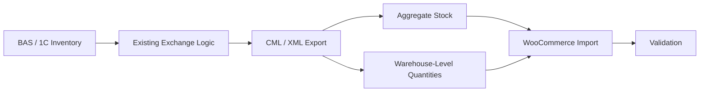

[← Portfolio](../../README.md) · [eBay / KeyCRM case](../ebay-keycrm-erp/README.md)

# BAS / 1C → WooCommerce: Multi-Warehouse Stock Extension

**Type:** Enhancement / E-commerce Integration  
**Environment:** Existing commercial exchange  
**Technologies:** BAS / 1C, WooCommerce, CML / XML

## Overview

I enhanced an existing BAS / 1C → WooCommerce exchange so that WooCommerce could receive stock quantities per warehouse instead of only a single aggregate stock value.

The integration already existed and was operating. My task was to extend its inventory model while preserving compatibility with the current exchange.

## Problem

The existing exchange transferred product and stock data, but inventory was represented as a general quantity.

For a multi-warehouse setup this was not enough: the business needed the export to preserve how stock was distributed between individual warehouses.

The change therefore had two requirements:

- add warehouse-level quantities;
- avoid breaking the existing BAS / 1C → WooCommerce exchange.

## My Responsibility

- analysed the existing exchange flow;
- inspected the CML/XML structures used for stock transfer;
- traced where inventory quantities were generated and mapped;
- extended the export logic with warehouse-level quantities;
- preserved the existing exchange contract where possible;
- validated the resulting data on a separate test database.

## Technical Approach

Rather than replacing the integration, I modified the existing stock-export path.

The work consisted of:

1. inspecting the current BAS / 1C export structure;
2. identifying how aggregate stock was represented in CML/XML;
3. adding warehouse-level quantity data to the export;
4. verifying that the new structure remained compatible with the existing WooCommerce-side flow;
5. testing the modified exchange separately before relying on it in the live workflow.

## Architecture

## Key Engineering Challenges

### Extending an existing exchange

The goal was not to redesign a working integration. The new warehouse data had to fit into the existing flow with minimal disruption.

### Multi-warehouse semantics

Stock had to remain associated with the correct warehouse instead of being flattened into one total quantity.

### Compatibility

Changes to CML/XML structures can affect downstream import logic, so the extension had to be validated against the existing WooCommerce exchange behaviour.

## Result

The existing BAS / 1C → WooCommerce exchange was extended to support warehouse-level stock quantities while retaining the existing integration flow.

The modified export was validated on a separate test database before use.

## Technology / Domain

- BAS / 1C
- WooCommerce
- CML / XML
- inventory synchronization
- multi-warehouse stock
- data mapping
- e-commerce integration
- integration debugging
- test-environment validation

## Privacy

This case describes work on an existing commercial integration. Client identity, credentials, internal business data, and other sensitive information are intentionally omitted.

[← Back to portfolio](../../README.md)
