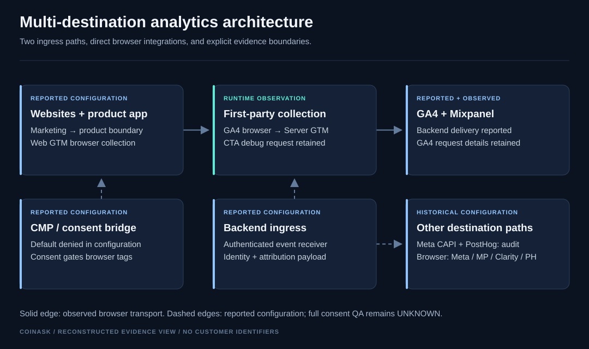
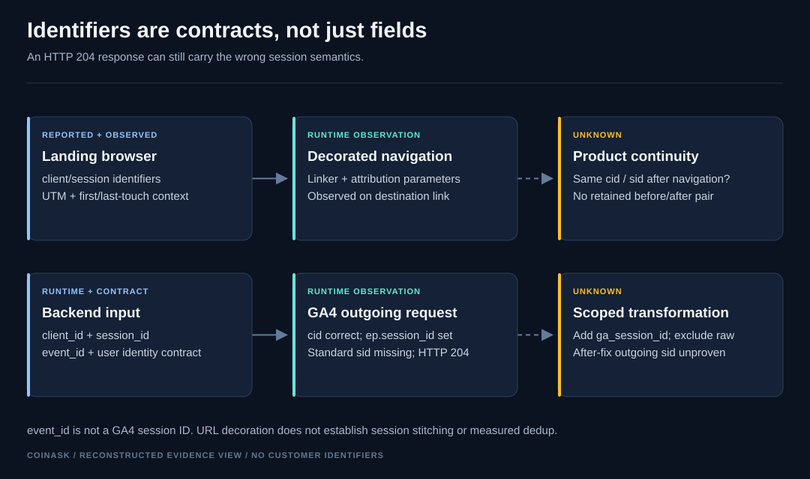
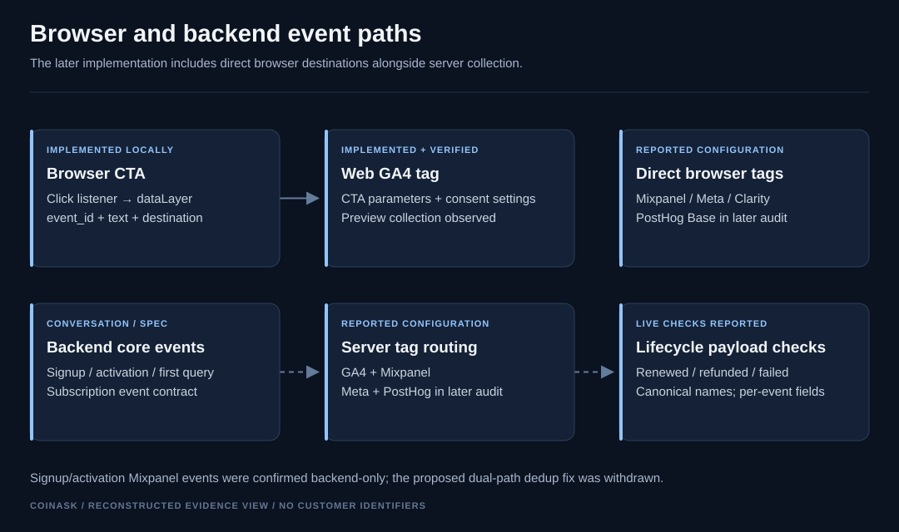
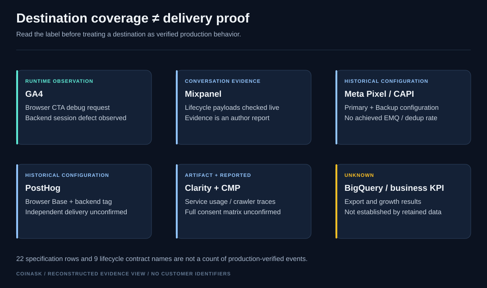
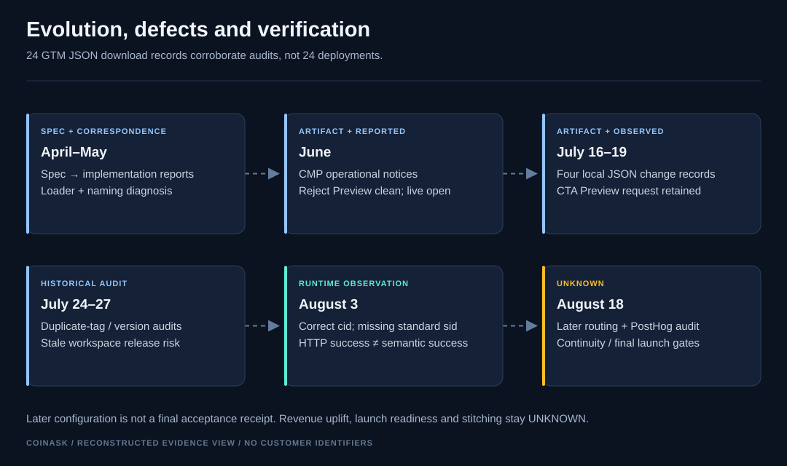

[← Portfolio](../../README.md) · [Evidence & limits](evidence.md)

# SaaS Product & Marketing Analytics Infrastructure
### CoinAsk · Browser + server measurement · Identity, attribution & data quality

I implemented and debugged parts of a SaaS analytics pipeline across marketing pages and a product application: browser collection, backend events, destination routing, consent gates and data contracts.

**Stack evidenced in retained material:** Web GTM · Server-Side GTM · Stape · GA4 · Mixpanel · Meta Pixel / CAPI · Consentmanager / Consent Mode v2 · Clarity. **PostHog** appears in the later configuration audit; independent delivery confirmation is unavailable.

My role was tracking integration and debugging against a client-provided architecture, coordinating frontend/backend contracts and checking configuration and runtime behavior. Product application development remained with the client team.

The diagram distinguishes runtime observations from reported configuration. Browser integrations existed alongside server collection; the original “everything through one hub” specification does not describe every later path.

## Why this was engineering work

A successful HTTP response did not guarantee correct analytics semantics. A backend subscription event received **HTTP 204** while its session identifier was serialized as `ep.session_id`, with the standard GA4 `sid` absent. Separately, a stale workspace could restore obsolete destination settings despite newer published versions.

The work involved tracing those boundaries, changing narrowly scoped configuration and separating Preview results from production conclusions.

## Identity & attribution

The retained request observation shows correct `client_id → cid` propagation and an incorrect `session_id` field. A later audit reports two scoped transformations: add `ga_session_id` and exclude the original `session_id` for the GA4 backend tag. **The after-fix outgoing request is UNKNOWN.**

UTM capture, first/last-touch storage, user attribution fields and link decoration are evidenced at different levels. A decorated link is not proof that the destination kept the same GA4 client and session.

## Event paths

| Event | Source | Browser / server | Destinations evidenced | Identity | Evidence |
|---|---|---|---|---|---|
| `page_view` | Google tag | Browser → server; separate Meta browser path | GA4; Meta Primary/Backup in later audit | Browser identifiers | CONVERSATION / SPEC EVIDENCE |
| `cta_click` | Click listener / dataLayer | Browser | GA4 request observed; Mixpanel tag reported | `event_id`, browser `cid/sid` | IMPLEMENTED + VERIFIED for the scoped Preview request |
| `signup_complete` | Product backend | Server | GA4, Mixpanel; Meta/PostHog in later audit | `user_id`, `event_id` contract | CONVERSATION / SPEC EVIDENCE |
| `first_ai_query` | Product backend | Server | GA4 trigger added; Mixpanel, Meta, PostHog reported | Backend identifiers | CONVERSATION / SPEC EVIDENCE |
| `subscription_started` | Product backend | Server | GA4 request observed; other routes reported | `client_id`, `session_id`, `event_id` | RUNTIME OBSERVATION, including session defect |
| `subscription_renewed`, `subscription_refunded`, `payment_failed` | Lifecycle backend | Server | Mixpanel live checks reported | Per-event and attribution fields | CONVERSATION / SPEC EVIDENCE |

The original event map contains **22 event-family rows**, including a dynamic quiz-step family. Later correspondence expands the subscription contract to **9 lifecycle names**. Neither number establishes the total implemented or production-verified event count.

## Defects → fixes → verification

| Defect | Why it mattered | Change / response | Verification retained |
|---|---|---|---|
| GA4 session field became `ep.session_id` | HTTP success could conceal missing session semantics | Scoped add/exclude transformations reported later | Before-fix request retained; after-fix `sid` UNKNOWN |
| GTM loader missing from product builds | Frontend events could not reach destinations | Located the app-shell/deployment boundary; handed off to frontend | Repeated HTML/JS diagnosis; later reports show loader on product/landings |
| Broad CMP event / necessary-purpose interpretation | Tracking could start before analytics/marketing choice | Dedicated consent event and explicit purpose gating | Reject clean in Preview; full live accept/revoke matrix UNKNOWN |
| Mixpanel Title Case mapping | Canonical backend names and routing disagreed | Backend mapping changed to snake_case; lifecycle payload extended | May 26 report names live events and received fields |
| CTA listener used the wrong signup path; GA4 mapping missing | Relevant clicks could be missed by the measurement path | Listener path correction + GA4 CTA tag | Direct local diffs; July 19 Preview request |
| Meta source URL used landing URL | Conversion context could be attributed to an earlier page | Canonical event source with landing fallback | Direct local JSON diffs; later configuration audit |
| First AI query absent from GA4 backend routing | One core backend signal lacked that destination | Added backend trigger | Local patch history + later audit; delivery receipt unavailable |
| Two Third CAPI tags targeted one dataset | Configuration could send a conversion twice to one destination | Legacy duplicate removed; Third later removed entirely | Version audit; actual duplicate volume UNKNOWN |
| Workspace drift could restore old Meta settings | An unrelated GA4 release could regress destination configuration | Compared workspace with published baseline; stopped unsafe publication | Retained audit decisions and version history |

The suspected Mixpanel dual-path signup/activation duplicate was **withdrawn** after the team confirmed backend-only delivery. I do not claim to have fixed a duplicate path that the later evidence says did not exist.

## Evolution & implementation evidence

There are **24 retained GTM JSON download records**, spanning July 16–August 18, 2026. They corroborate the export/audit history; they are not 24 deployments. The complete export files are currently unavailable.

Four untruncated local JSON diff records retain actual implementation changes: server variable references/fallback, Meta payload source fields, the CTA listener, and the GA4 CTA tag. Their scope is **IMPLEMENTED locally**, not proof of production publication. [Sanitized excerpts and provenance](evidence.md#retained-code-changes).

## Engineering outcome & limits

The retained evidence supports hands-on integration of browser/backend measurement, concrete lifecycle payload checks, a debuggable event contract, and configuration release-safety work. It also preserves unresolved defects rather than hiding them behind commercial closure.

**UNKNOWN:** final launch-ready acceptance; final cross-domain client/session continuity; after-fix GA4 session serialization; BigQuery export; complete consent QA; business conversion/revenue/ROAS impact. The later audit also leaves hostname filtering, onboarding routing and Meta revenue fields open.

[Read the evidence ledger →](evidence.md)
