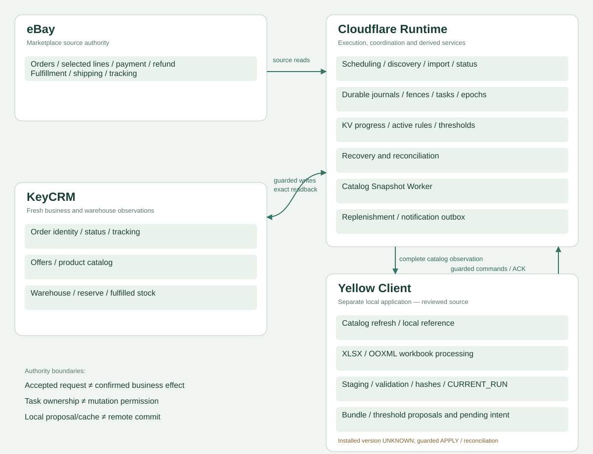
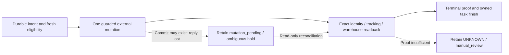
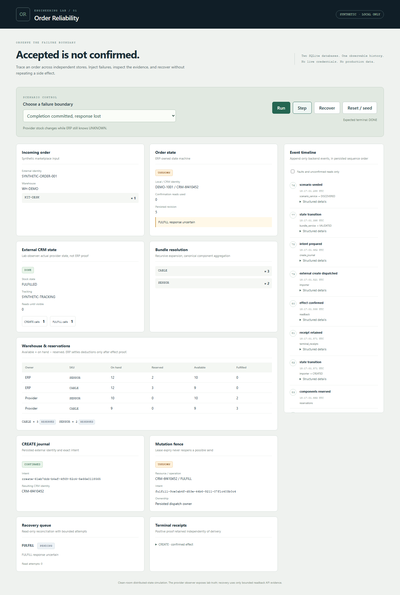
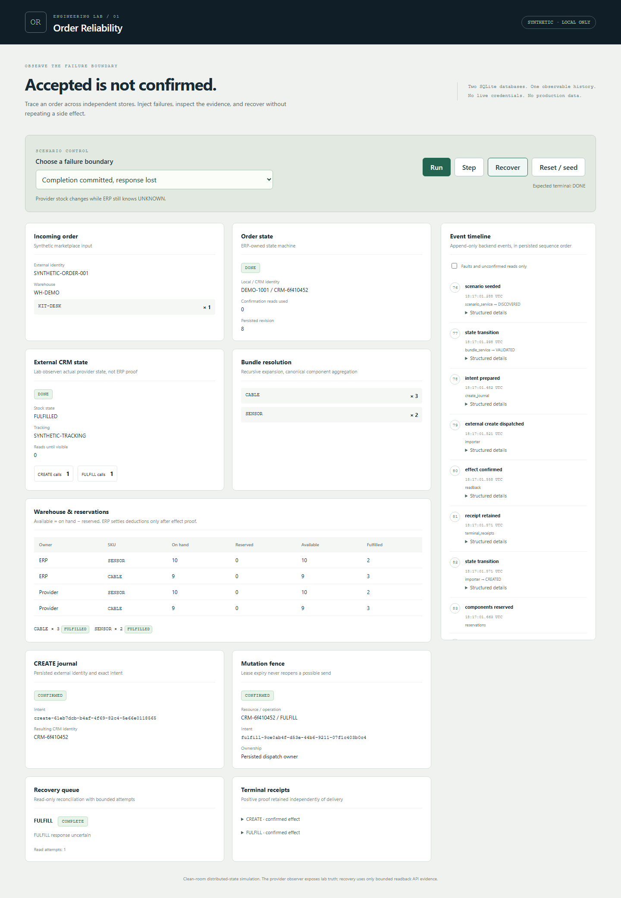

[← Portfolio](../../README.md) · [BAS / WooCommerce case](../bas-woocommerce-multiwarehouse/README.md)

# eBay / KeyCRM — Production ERP / OMS Reliability

Systems: **eBay · Cloudflare Runtime · KeyCRM · Yellow Client**

Production ERP / OMS reliability engineering around marketplace orders, warehouse state, bundles, guarded mutations, durable recovery and reconciliation.

Reviewed snapshot: **1,208 normalized architectural relationships · 54 components · 40 modeled state entities · 28 implemented safeguards**

Architecture census from the reviewed source/state snapshot — **not runtime telemetry**. Components include logical/support/history areas; not every relationship or local correction is proven active in production.

[Diagram source](assets/architecture-overview.mmd) · [Deeper system map](architecture/full-system-map.md) · [Evidence classes and limits](architecture/evidence.md)

## The engineering problem

An accepted API request, a created CRM identity, a warehouse reserve, a fulfilled line and a completed queue task are different facts. A timeout can occur after a stock-affecting operation has already committed. Recovery must establish what happened without repeating the effect.

I worked on an existing commercial integration: tracing deployed versus editable behavior, diagnosing order/warehouse failures, reproducing edge cases, implementing and regression-testing safeguards, and preserving release gates where compatibility or historical effect evidence remained incomplete. This is integration and warehouse workflow engineering, not a claim of a standalone full-featured ERP/WMS product.

**Technologies:** JavaScript / Cloudflare Workers / Durable Objects / SQLite-backed storage / KV / REST APIs / OAuth / PowerShell / XLSX / OOXML / workerd.

## Seven chains worth reading first

| Chain | Why it matters | Evidence scope |
| --- | --- | --- |
| [Discovery starvation](architecture/critical-chains.md#cc02--discovery-starvation) | Repeated first pages can prevent an order from ever reaching a journal or warehouse flow. | OBSERVED DEFECT / local correction |
| [Serialized duplicate prevention](architecture/critical-chains.md#cc06--serialized-duplicate-prevention) | Outer lookup and source-identity journal protect different race windows. | IMPLEMENTED |
| [CREATE committed, response lost](architecture/critical-chains.md#cc08--create-committed-response-lost) | Positive identity reconciliation, never blind recreate. | IMPLEMENTED + TESTED |
| [Guarded fulfillment PUT](architecture/critical-chains.md#cc13--one-guarded-fulfillment-put) | Epoch, CRM fence, exact readback, warehouse proof and receipt. | VERIFIED PRODUCTION bridge scope |
| [Lost task acknowledgement](architecture/critical-chains.md#cc29--lost-task-finish-acknowledgement) | Reconcile delivery metadata without replaying the mutation. | IMPLEMENTED + TESTED |
| [Yellow APPLY ACK lost](architecture/critical-chains.md#cc40--yellow-apply-ack-lost) | Exact pending command differs from current remote hash. | Local/test source; installed Yellow UNKNOWN |
| [Catalog page failure](architecture/critical-chains.md#cc39--catalog-refresh-page-fails) | Incomplete refresh cannot replace a complete snapshot. | IMPLEMENTED + TESTED |

## The reliability boundary

Production separates source-identity CREATE journals, CRM-ID PUT fences/tombstones, typed delivery leases and root cutover epochs. Retrying computation does not authorize replaying an external effect. A newer source revision, expired lease, missing KV or current DONE cannot erase unresolved prior mutations.

Bundle expansion uses the active effective rule map and exact component/catalog identities. Numeric warehouse, quantities, reserved and fulfilled observations are checked independently. Replenishment thresholds are policy, not stock quantities. Yellow's staging/hash/CURRENT_RUN and exact command journals are local application facts, not remote commit proof.

## Executable reliability model

Verified lab: **PUBLIC DEMO — 68 automated tests · 15 executable scenarios · 8 deterministic fault modes**

Commercial architectural principles → **independent clean-room public implementation**. The lab contains synthetic data and no private production implementation. Demo metrics are not production metrics; implementation is not a one-to-one port.

| Production architectural pattern | Public lab implementation |
| --- | --- |
| Source-identity CREATE journal | Persisted CREATE journal and exact intent fingerprint |
| Mutation fence | SQLite-backed PREPARED / SENT / UNKNOWN / CONFIRMED fence |
| Ambiguous external result | Deterministic commit-then-timeout fault |
| Bounded readback | Exact identity, warehouse, lines, tracking and intent policy |
| Recovery ownership | Persisted task and owned lease |
| Terminal proof | Immutable receipt before local settlement |
| Warehouse verification | Independent ERP/provider inventory observations |

[Run / inspect the lab](../../demos/order-reliability/README.md) · [Verification receipt](../../demos/order-reliability/docs/VERIFICATION.json) · [GitHub Actions](https://github.com/Faleovad/portfolio/actions/workflows/order-reliability.yml) · [All five captures and proofs](architecture/demo-gallery.md)

### Provider committed; ERP cannot yet confirm

Actual React console after the published `completion_lost` scenario: provider DONE; ERP UNKNOWN; fence UNKNOWN; local components still RESERVED; recovery task PENDING. No second fulfillment call.

### Read-only recovery completed

The same run after recovery: immutable fulfillment receipt, COMPLETE task, local settlement and still one provider FULFILL call. These screenshots demonstrate the lab, not private production UI or live stock.

## Evidence and release boundaries

Saved production reports through October 2026 support deployed import/status/replenishment/snapshot flows and selected natural completion/readbacks. They are not raw private receipts or a fresh production audit. The reviewed current RC differs from serving production. The production-candidate aggregate runner retains **EXIT1**; full RC and later minimal patch remain separately scoped **NO-GO**. Installed Yellow version remains **UNKNOWN**.

Architecture closure and local tests do not establish lifetime order volume, uptime, latency, unconditional exactly-once effects, complete historical backlog reconciliation or catastrophic restore. [Production evidence & limitations](architecture/evidence.md) keeps these distinctions explicit.

## Explore the system

- [System architecture](architecture/full-system-map.md)
- [50 critical chains](architecture/critical-chains.md)
- [Failure & recovery map](architecture/failure-recovery-map.md)
- [Order-lost diagnostic tree](architecture/order-lost-diagnostic.md)
- [40-entity state authority map](architecture/state-authority-map.md)
- [28 implemented safeguards](architecture/safeguards.md)
- [Full forensic relationship graph — sanitized projection](architecture/full-forensic-graph.md)
- [Production evidence & limitations](architecture/evidence.md)
- [Executable Order Reliability Lab](../../demos/order-reliability/README.md)
- [Demo verification](../../demos/order-reliability/docs/VERIFICATION.json) / [CI](https://github.com/Faleovad/portfolio/actions/workflows/order-reliability.yml)

## Privacy / NDA

Client identity, real order/tracking/SKU/customer fields, credentials, infrastructure identifiers, route predicates, private receipts and customer workbooks are omitted. Architecture maps are sanitized semantic views, not operational access instructions. Public demo code and screenshots use synthetic state only.
