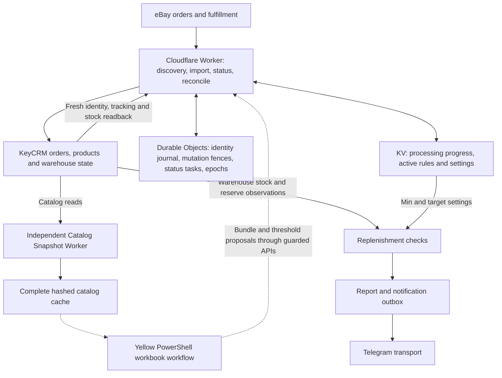
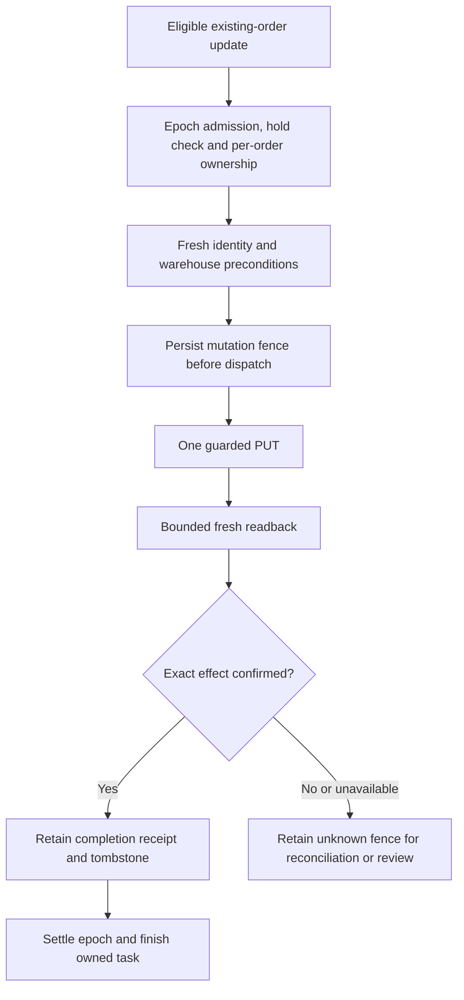

[← Portfolio](../../README.md) · [BAS / WooCommerce case](../bas-woocommerce-multiwarehouse/README.md)

# eBay / KeyCRM — Production Order & Warehouse Reliability

**Type:** Reliability Engineering / ERP & OMS Integration  
**Environment:** Existing commercial system  
**Technologies:** JavaScript, Cloudflare Workers, Durable Objects, SQLite-backed storage, KV, REST APIs, OAuth, PowerShell, XLSX / OOXML, workerd

## Overview

I investigated and hardened an existing order-processing system around eBay and KeyCRM. The system connected order import, bundle decomposition, warehouse reservations, fulfillment and tracking synchronization, replenishment reporting, and catalog distribution.

The central problem was deciding whether a business operation had actually completed. An accepted API request, a completed queue item, and fulfilled warehouse stock are different facts. Recovery had to preserve those distinctions to avoid repeating a potentially stock-affecting operation.

This is an ERP / OMS integration with warehouse workflows. It is not presented as a standalone, full-featured ERP or WMS product.

## Operational Problem & My Responsibility

An order could cross several boundaries before it was safe to call it complete: marketplace identity, SKU and bundle mapping, CRM creation, warehouse assignment, reservation, fulfillment, tracking, and durable settlement. A timeout or lost acknowledgement could leave only part of that chain confirmed.

My responsibility was to trace the existing system, compare deployed behavior with editable source, diagnose order and warehouse failures, reproduce edge cases, and implement and regression-test safeguards. I also documented state ownership and kept corrective releases gated when compatibility or historical mutation evidence was incomplete.

This was work on an operating integration, including local corrective candidates; it was not a greenfield replacement, and local fixes were not automatically production deployments.

## Architecture

The solid paths summarize the retained production architecture. Dashed paths show the selected Yellow client implementation; its installed version was not independently attested.

Durable Objects used platform SQLite-backed persistence through the storage API. KV progress records, active configuration, durable mutation journals, and catalog caches had separate responsibilities. A cache or expiring progress record could not authorize replay of a business mutation.

### Runtime flows

- **Order import:** discover modified eBay orders, normalize selected lines, expand bundles, resolve catalog identities, and perform exact duplicate checks before coordinated CRM creation. Warehouse validation follows identity creation.
- **Status and tracking:** capture existing-order work in a durable typed handoff, re-read source and CRM state, evaluate payment/refund/fulfillment policy, and send a guarded update only when eligible. Fresh readback verifies the resulting state.
- **Reconciliation:** compare source and CRM identities and delegate work to the existing mutation owners. Observation and recovery scheduling do not bypass mutation fences.
- **Replenishment:** compare warehouse-specific quantities and reserves with minimum/target settings, then prepare attention reports and notifications. This flow does not transfer stock or create purchase orders.
- **Catalog snapshots:** an independent Worker reads catalog pages, sanitizes and hashes the complete result, and publishes one cached snapshot. A failed refresh leaves the previous complete cache available.

The mapped production configuration had four main cron expressions and one independent snapshot schedule. This is a schedule count, not a microservice or throughput count.

### Yellow workbook workflow — code and test evidence

The selected Yellow runtime contains seven PowerShell scripts for XLSX/OOXML processing, catalog refresh, pending-proposal reconciliation, bundle synchronization, and stock-threshold settings. Preparation uses staging, validation, a success marker, hashes, and a published `CURRENT_RUN` pointer.

Remote command intent, positive server acknowledgement, and local cache repair are separate steps. An atomic run pointer does not roll back earlier reference changes or a remote APPLY. The installed client package, launcher, and pending-command state remained unknown; the tested scripts are not proof that the customer had those exact bytes installed.

## Reliability Model

### Idempotency & external side effects

The production status bridge used a per-CRM mutation fence persisted before dispatch. An unknown result remained fenced after lease expiry. A confirmed completion retained a tombstone so a stale task could not repeat the transition.

The inspected CREATE implementation has a separate source-identity journal and repeats the exact duplicate check inside the named coordinator. Its pre-send intent and ambiguous-outcome states prevent a negative lookup from becoming permission to send another CREATE. The current candidate's exact confirmation logic is not assumed to match every deployed CREATE path.

For status updates, HTTP `200` or `202` is candidate acceptance. Fresh reads must establish the relevant identity, status, products, warehouse, fulfilled quantities, and tracking. A lagging readback can lead to bounded additional reads, not a repeated PUT.

This describes protocol safeguards, not an unconditional exactly-once guarantee across every external writer.

### Recovery & reconciliation

The selected production status handoff uses capture, claim, revision ownership, a due index, and owned finish receipts. A delivery lease grants task ownership; it does not grant permission to bypass a CREATE journal or PUT fence.

A lost task-finish acknowledgement is a metadata settlement problem. Reconciliation checks the owning receipt instead of repeating the external mutation. Likewise, queue completion, CRM identity creation, warehouse fulfillment, and epoch settlement remain separate terminal facts.

There was no generic automatic resolver for every sent-but-unknown mutation. Historical cases without sufficient receipts or linked stock-effect evidence remained held, even when a current dry plan looked eligible. Current stock or a missing KV record could not reconstruct an unknown historical deduction.

### Warehouse & bundle logic

Bundle expansion used the effective active rule map, then resolved component identities and quantities. A valid parent order was insufficient if component resolution or warehouse validation was incomplete.

The inspected validation code distinguishes reserved from fulfilled stock and checks aggregate SKU quantities, numeric warehouse identity, and line-level stock state. More stringent local warehouse and malformed-rule fixes are described as candidate changes, not deployed behavior.

Replenishment thresholds are policy, not stock quantities. Catalog presence is product evidence, not proof of a current reservation or a historical warehouse movement.

## Release Safety

Deployed version and traffic attestations were treated separately from uploaded artifacts and local builds. The release process used pinned inputs, scope and configuration comparisons, encrypted checkpoints, operation-intent journals, and compatible forward recovery.

Participating writers used persistent `STOP` / `DRAINED` / `RUN` control and expected epochs. Stopping admission does not cancel a request already accepted by an external provider, so unknown mutation evidence still had to be retained.

As of the 31 October 2026 evidence snapshot:

- The full release candidate was not interchangeable with the serving status controller or existing settings authority.
- A later minimal patch avoided that particular incompatibility, but remained **NO-GO** pending authentic protocol tests, matching publication tooling, and fresh operational proof.
- Yellow's prepared code update was not an accepted runnable client distribution.
- Native persistence and continuity tests did not establish complete disaster restoration.

## Production Evidence

The evidence reviewed for this case is dated October 2026. It is not a live attestation of the system's current state.

| Observation | What it supports | Boundary |
| --- | --- | --- |
| Saved deployment/version and traffic attestations through 30 October | The main runtime was deployed and serving; its identity was distinguished from local candidates. | Editable RC source is not the serving artifact. |
| 28 October natural cron completion with tracking, fulfilled warehouse lines, queue completion, and one attempt | A documented recovery completed through the ordinary processing path. | Saved report; not a public raw provider receipt. |
| The same recovery's quantity `6 → 5` and reserve `1 → 0` readback | One documented expected deduction and reserve release. | Not a global stock-ledger or no-double-deduction proof. |
| Separate routine new-order completion and three exact unique CRM samples | The reports cover ordinary processing as well as a recovery example. | A bounded sample, not a lifetime processing total. |
| Catalog snapshot GET success with 326 offers on 28 October | The independent catalog service had a recorded complete catalog observation. | Offers are not orders or stock units. |

### Evidence provenance

The private review basis was a 31 October evidence pack cross-referencing architecture maps, module/state inventories, source functions, dated operational reports, and test receipts. The following document names identify the source categories; they are intentionally not links to inaccessible local files:

- `PORTFOLIO_EVIDENCE_PACK_20261031.md` — claim-by-claim classification.
- `FINAL_ARCHITECTURE_MAP_20261031.md`, `FINAL_MODULE_CLOSURE_20261031.md`, and `FINAL_DEPENDENCY_AND_STATE_MAP_20261031.md` — architecture and state ownership.
- `STATUS_ACK_20261026.md` and `OWNER_ACCEPTANCE_20261028.md` — dated operational observations.
- `RELEASE_TEST_MATRIX_20261031.md` and `COMPATIBILITY_REMEDIATION_GO_NO_GO_20261031.md` — test scope and remaining release gates.

**Saved operational reports are not raw private production receipts.** The latter were outside the permitted review scope and are not published. This public case provides a sanitized account and evidence boundaries, not an independently reproducible public production audit.

## Verified Numbers

| Number | Exact meaning |
| --- | --- |
| **96** | Effective bundle rules in the dated retained production evidence. |
| **384 + 384** | Two scoped bundle-comparison sets: semantic expansion and independent full-row differential checks. Not order volume. |
| **4 + 1** | Main cron expressions plus the independent snapshot schedule. |
| **54 / 54** | Logical architecture areas classified, including support, history, and unknown areas. Not 54 deployed services or passing integration tests. |
| **40** | Proven defect classes in the review inventory. Not 40 observed incidents or 40 deployed fixes. |
| **41,277 physical LOC** | Selected maintained source snapshot: 22,442 runtime, 13,063 tests, and 5,772 tooling. Includes comments and blank lines; excludes separately counted support/history/generated artifacts. |

The LOC figures belong to the pinned architecture snapshot, not a fresh count after later tooling edits. Original handwritten production LOC, total processed orders, uptime, latency, and a unique global test count were not established.

## Failure Cases & Testing

| Failure investigated | Evidence and correction boundary |
| --- | --- |
| Discovery restarts at a capped page window and never reaches the next candidate | Reproduced against retained serving behavior; local continuation, restart, partial-prefix, and persistence-fault regressions cover the correction. |
| Accepted update has stale readback or a date-only disagreement | A serving incident fix used bounded confirmation reads and retained a date warning where independent completion evidence was valid. It did not repeat PUT. |
| Provider may commit CREATE before its response is lost | Two combined compiled-runtime mock scenarios covered normal and lost-response/restart behavior: one CREATE and zero PUTs per scenario. |
| Malformed bundle components, ambiguous rule identity, or quantity overflow | Local rule-validation fixes and differential comparisons; not evidence that actual production orders suffered those faults. |
| Queue or command acknowledgement is lost | Separate durable ownership/receipt checks and conservative unknown handling; no mutation replay just to obtain an acknowledgement. |

The retained test matrix includes mock transports, comparisons with exact retained production code, compiled-runtime tests, and native workerd/SQLite restart tests. Examples include 13 discovery cases, 20 mutation cases, 16 bundle regressions, 15 recovery cases, and 5 native recovery restart cases. These are scoped suite counts and should not be summed into a unique global total.

**The aggregate runner remained `EXIT1`** at a known HTTP `409` / mutation-sent / manual-review fault-test contract. The unchanged baseline also reproduced the failure. Other scoped suites recorded successful results, but the overall regression gate was not green. Later minimal-patch fixtures that failed before reaching their target mutation behavior were not counted as acceptance tests.

## Result & What Was Not Claimed

The work produced a traceable operational model, reproduced failure cases, locally tested corrections, and an explicit separation between observed production behavior and candidate improvements. Saved reports document natural completion and recovery while unresolved historical effects remained protected from speculative replay.

This case does not claim that every fix was deployed, all historical orders were reconciled, the latest candidate was release-ready, or the installed Yellow client matched the reviewed source. It also does not claim tenant-global rate coordination, unconditional exactly-once effects, complete disaster recovery, measured uptime, or processing volumes inferred from order IDs.

## Privacy / NDA

This case is based on commercial work. Customer identities, order and tracking identifiers, SKUs, credentials, production endpoints, infrastructure identifiers, private receipts, and client workbooks are omitted. The diagrams describe responsibilities and data boundaries; they do not expose a deployment topology suitable for accessing the live system.

[← Back to portfolio](../../README.md)
