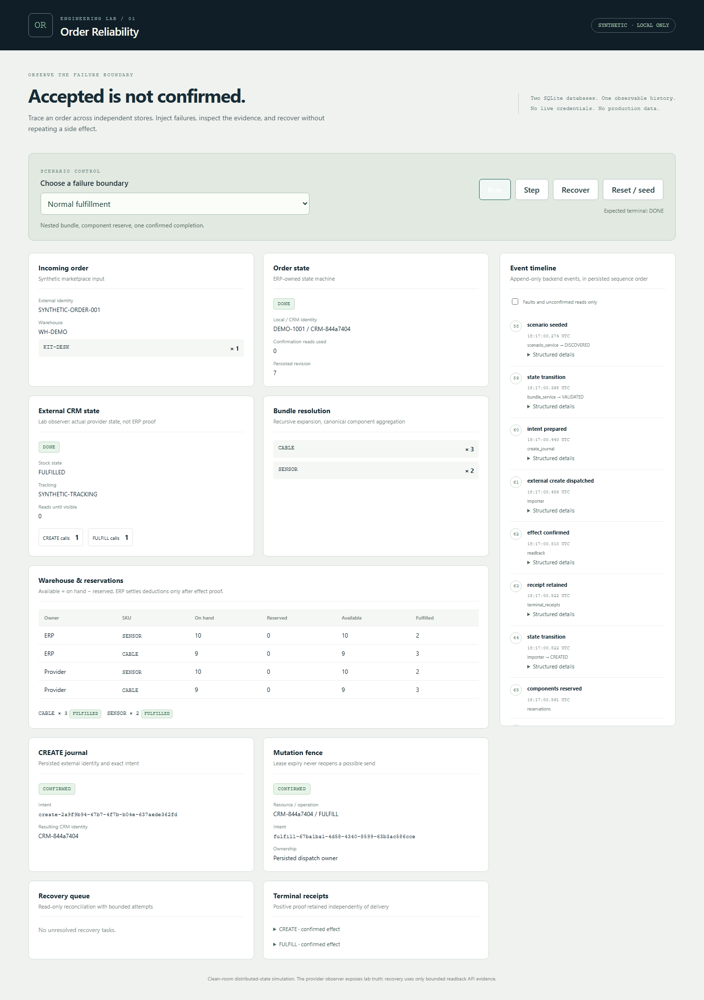
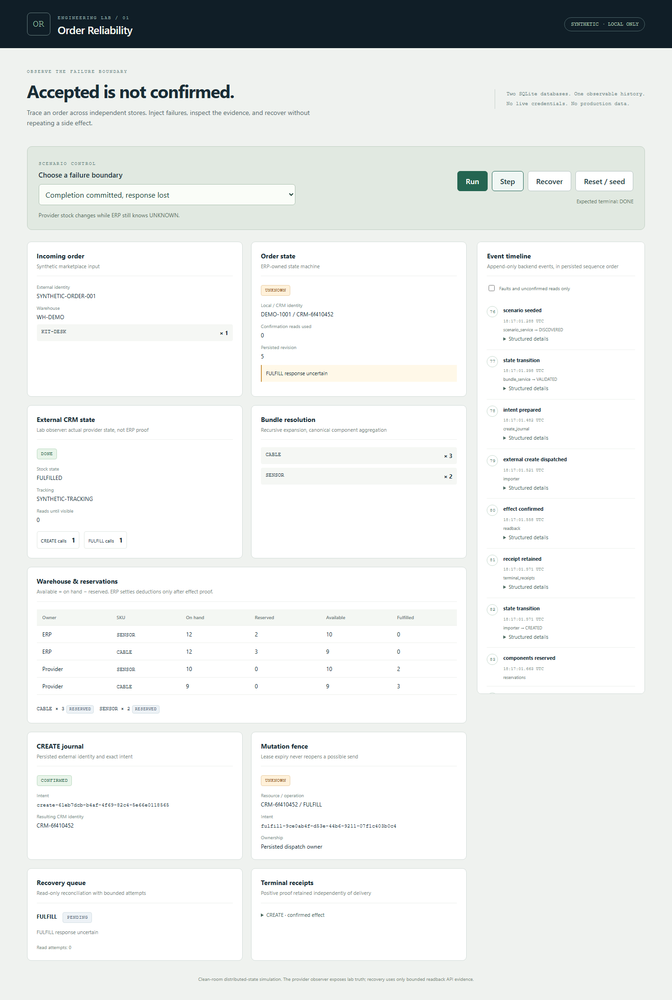
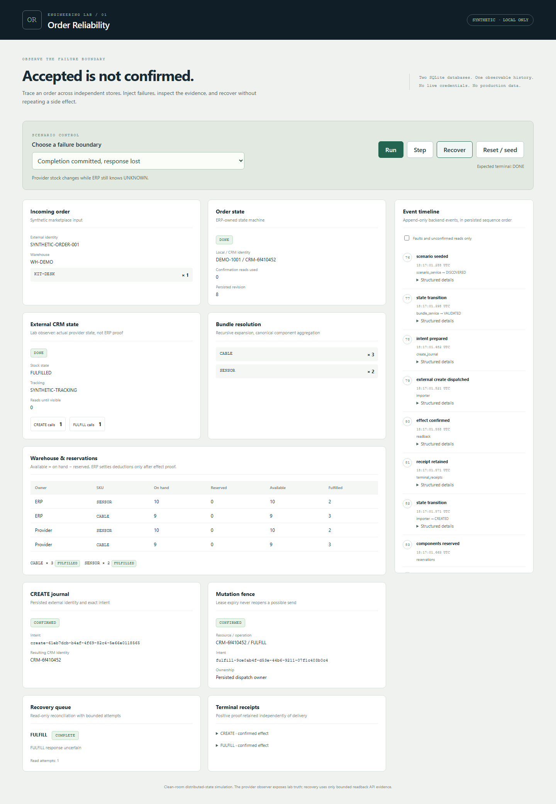
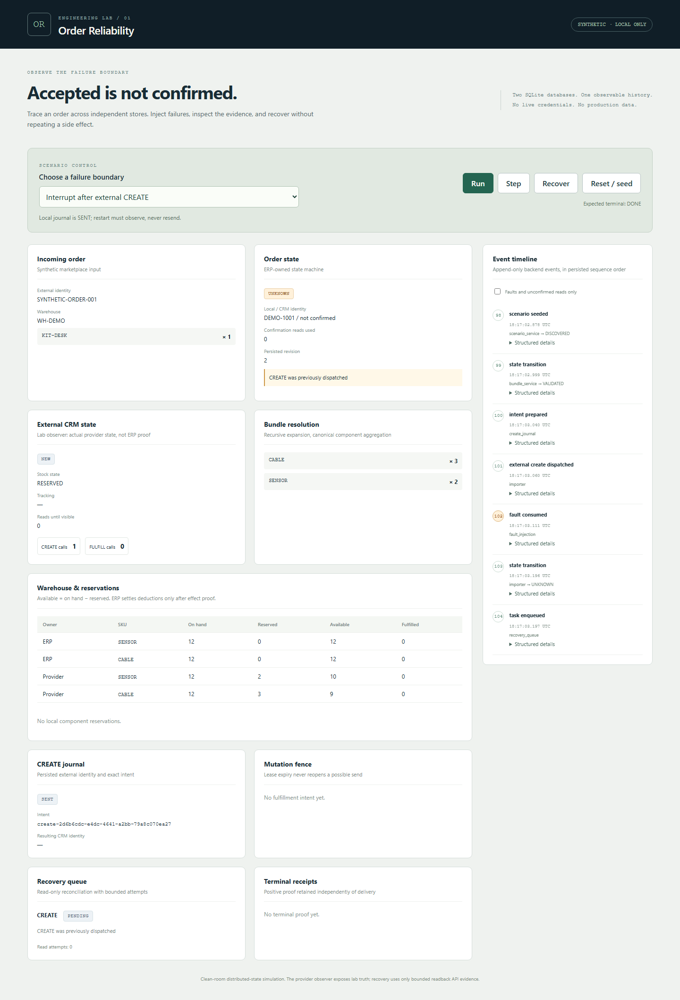
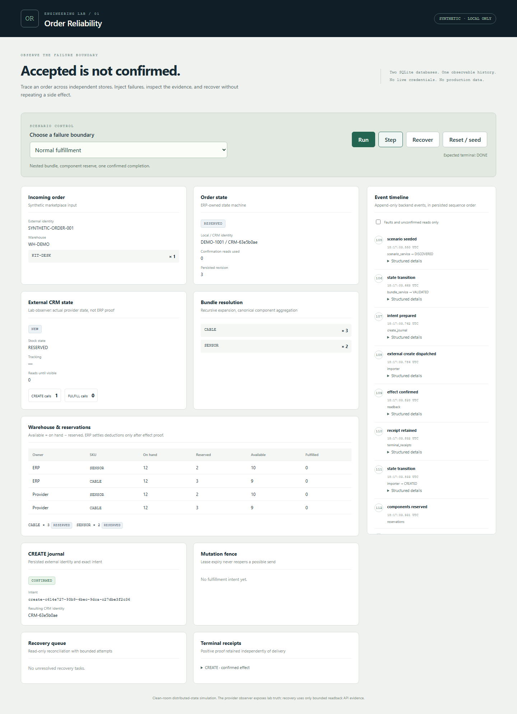

[← Case study](../README.md) · [Executable lab](../../../demos/order-reliability/README.md) · [Evidence](evidence.md)

# Real console captures — PUBLIC DEMO

Captured from the running React console and FastAPI API using the published clean-room implementation at commit `1e1e923e4a160d47bea0c08645dc64e612a00186`. No production UI, customer data or private implementation is depicted. No overlay changes business values. [Capture evidence](../assets/capture-verification.json) records actions, asserted backend state, provider call counts, event sequences and image hashes.

## 1. Normal execution

`happy`: Reset / seed → Run. ERP DONE, provider DONE, fulfilled component inventory, retained CREATE and fulfillment receipts. The event timeline comes from backend events.

## 2. Commit then timeout

`completion_lost`: Reset / seed → Step × 5. Provider DONE; ERP UNKNOWN; mutation fence UNKNOWN; local reservation remains RESERVED; recovery task PENDING. Exactly one CREATE and one FULFILL provider call. This is actual divergent state in the demo's two SQLite databases.

## 3. Read-only recovery complete

Continue the same run → Recover. Exact effect confirmed, immutable FULFILL receipt retained, task COMPLETE, local reserve settled, still one FULFILL call. Recovery did not send another provider mutation.

## 4. Repeat CREATE prevented by persisted journal

`interrupt_create`: Run stops after provider CREATE but before the local caller receives a completed identity. Step retries application computation with the same external identity. The existing SENT journal prevents another CREATE, moves the order to UNKNOWN and enqueues CREATE reconciliation. Provider ledger remains at one CREATE and zero FULFILL calls. This is a journal-protected retry, not an artificial second order or a UI-only counter.

## 5. Bundle / warehouse reservation

`happy`: Step × 3 pauses at RESERVED. KIT-DESK expands through KIT-CORE into SENSOR × 2 and CABLE × 3; both stores show on-hand, reserved, available and fulfilled separately. No fulfillment dispatch has occurred yet.

PNG captures are used instead of a heavy recording so small journal/stock fields remain readable. Their backend proofs are synthetic demo evidence, not raw production receipts.
