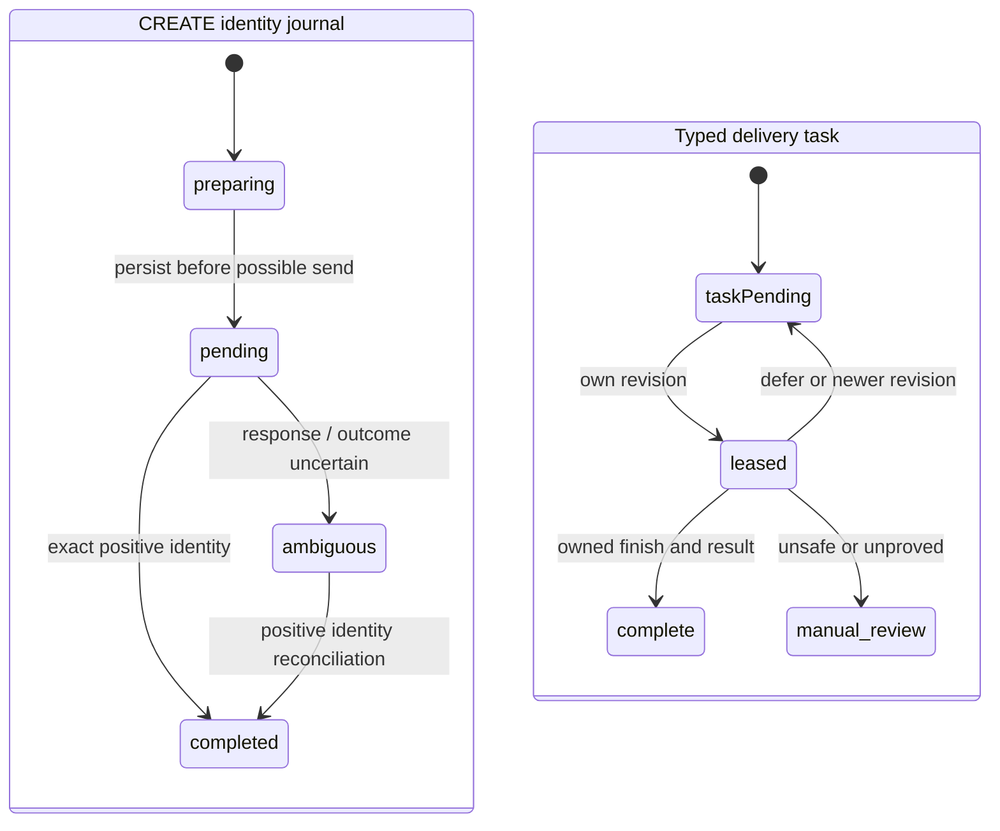

[← Case study](../README.md) · [Architecture index](full-system-map.md) · [Evidence labels](evidence.md)

# Failure propagation and read-only recovery

**Retrying computation is not the same as replaying a side effect.** The labels N/F/R and different line patterns remain meaningful without color: solid N = normal; long-dashed F = failure propagation; dotted R = recovery/observation. No recovery arrow loops back into the mutation send node.

```mermaid
flowchart LR
  plan["Eligible computation"] -->|"N: durable intent"| intent["Pending journal / fence"]
  intent -->|"N: one admitted dispatch"| send["Provider mutation"]
  send -->|"N: exact readback"| proof["Confirmed effect proof"]
  proof -->|"N: retain receipt"| terminal["Tombstone / epoch receipt / owned finish"]
  send -->|"F: commit then timeout / Worker stops"| unknown["UNKNOWN / ambiguous / mutation_pending"]
  unknown -->|"F: task or caller appears incomplete"| delivery["Delivery uncertainty is not permission to send"]
  unknown -.->|"R: claim persisted task and inspect fence"| read["Fresh read-only observation"]
  read -.->|"R: exact positive proof"| proof
  read -.->|"R: insufficient or conflicting proof"| review["Retained hold / manual_review"]
  terminal -.->|"R: lost finish ACK"| finish["Reconcile own finish / last_finished_lease"]
  linkStyle 4,5 stroke:#9e583c,stroke-dasharray:9 5
  linkStyle 6,7,8,9 stroke:#27716b,stroke-dasharray:2 5
```

## Independent machines, not one universal order enum

`pending` in CREATE retains `phase=in_flight` compatibility; legacy `in_flight` remains a recognized input. The state diagram is a source-backed simplification, not permission to reset journals. PUT uses `mutation_pending` and retained completion evidence; it is not the demo's uppercase enum. Epoch control separately uses STOP / DRAINED / RUN. Staged full recovery is not all production-enabled.

## Failure classes and safe continuation

| Break | Propagation | Safeguard / continuation | Terminal evidence |
| --- | --- | --- | --- |
| Discovery cap/partial page | Candidate never reaches journal or successful prefix is lost | Local continuation/prefix correction; prove capture before cursor | Coverage checkpoint, not a processed-order claim |
| CREATE response lost | Caller lacks CRM identity although provider may have created it | Source-identity journal; exact positive lookup; no POST replay | Completed identity, then separate reserve proof |
| PUT response lost | Warehouse may already be fulfilled; task may look incomplete | Per-CRM fence/root hold; bounded GET | Exact stock/tracking proof + compatible receipt settlement, otherwise review |
| Stale readback | Candidate acceptance does not establish effect | Bounded reads within policy; preserve pending after exhaustion | No terminal claim until matched |
| Worker stops | Persistent dispatch survives a lost process | Re-read journal/fence and persisted task; read-only reconcile | Existing operation proof, not another request |
| Finish ACK lost | Delivery metadata ambiguous after business effect confirmed | Own lease/last_finished_lease and terminal tombstone | Owned finish settlement; no PUT |
| Yellow ACK lost | Server may have committed while local command is pending | Exact pending intent; authority-aware receipt/version reconciliation | Positive command proof; legacy unknown remains held |
| Snapshot page fails | Partial candidate cannot replace complete cache | Publish-on-complete; retain prior snapshot | Complete envelope/hash/time |

**Evidence:** source reference T01–T14, F01–F17 failure analysis, SG01–SG28 catalog. Failure descriptors are not incident counts. The production system has no generic automatic resolver for all sent/unknown mutations. The [public lab](../../../demos/order-reliability/README.md) deliberately implements a narrower synthetic read-only recovery policy.
