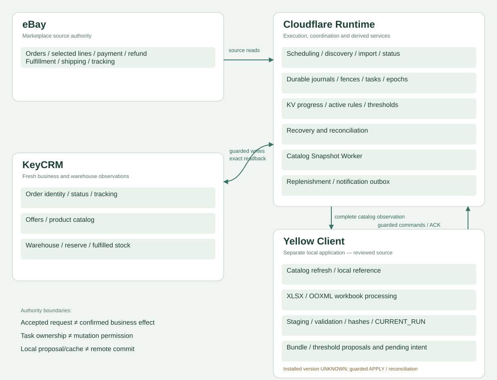
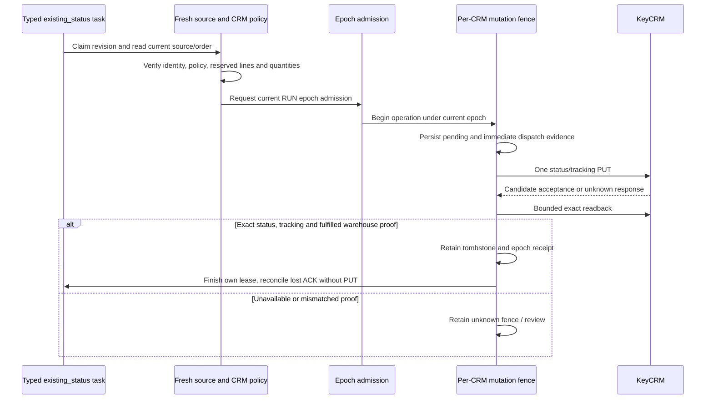
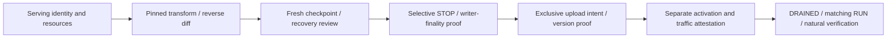

[← Case study](../README.md) · [Architecture index](full-system-map.md) · [Evidence labels](evidence.md)

# System topology: runtime, state and side-effect boundaries

**IMPLEMENTED source/state topology with dated VERIFIED PRODUCTION areas.** Not all depicted corrections, staged services or Yellow scripts are proven installed/live. [Evidence discipline](evidence.md) applies to every view.

The overview groups four systems; its 15-node Mermaid topology source expands the internal boundaries. Yellow is a separate local application, not an embedded Worker helper. Its selected code includes catalog/reference handling, XLSX/OOXML, staged publication, proposals, exact pending commands and cache reconciliation. Installed bytes remain UNKNOWN.

## Discovery, import and identity

```mermaid
flowchart LR
  source["eBay modified-order pages"] --> scan["Frozen discovery window / pagination"]
  scan --> coverage["Continuation / hot-tail / backlog admission"]
  coverage --> capture["Acknowledged capture before cursor"]
  capture --> normalize["Normalization / payment-refund policy"]
  rules["Active bundle rules"] --> normalize
  normalize --> components["Whole component plan / exact catalog resolution"]
  components --> lookup["Outer exact source-identity lookup"]
  lookup --> actor["Serialized CREATE coordinator / identity journal"]
  actor --> post["One guarded CREATE"]
  post --> identity["Exact positive CRM identity"]
  identity --> reserve["Separate warehouse reservation proof"]
```

**Scope:** frozen continuation/fixed-cutoff/partial-prefix corrections have local test evidence; retained discovery defects remain distinct. Positive post-CREATE identity GET details differ between current RC and serving bridge. See CC01–CC10.

## Status, warehouse and delivery

The diagram summarizes the retained bridge architecture, not byte identity with current RC. A queue lease is delivery ownership, not permission to CREATE or re-PUT. Completion is not inferred from a status code alone.

## Stores, services and client boundaries

| Area | Owned facts | Limits |
| --- | --- | --- |
| Durable Objects / SQLite-backed storage | Source CREATE journal; CRM mutation lock/tombstone; typed tasks; root epoch/hold/receipts | One deployed namespace/class can host different logical actor families. Not a custom production SQL schema claim. |
| Processing KV | Progress/history, frozen scan checkpoints | Expiry/absence cannot establish no external effect. |
| Active rules/settings KV | Effective bundle meaning and retained threshold authority | Cache/reference/fallback cannot replace authority. Staged R3 is not activated. |
| KeyCRM | Current order, catalog, numeric warehouse, reserve and fulfilled line observations | Current balance/DONE cannot reconstruct historical request/movement finality. |
| Snapshot Worker | Complete hashed catalog observation/cache | Publish only after complete pagination; not current stock or rule authority. |
| Yellow program | Local reference, staging, hashes, CURRENT_RUN, proposals/pending/cache receipts | Pointer publication does not roll back prior writes/APPLY. Installed version UNKNOWN. |
| Replenishment / outbox | Stock-versus-threshold decision, attention enqueue, delivery claim/dedupe/finish | Thresholds are not stock transfers; delivery ACK is not human receipt. |

## Yellow publication and remote commands

```mermaid
flowchart LR
  snapshot["Complete catalog observation"] --> reference["Yellow local reference"]
  reference --> workbook["XLSX / OOXML input and planning"]
  workbook --> staged["Staging / validation / SUCCESS / hashes"]
  staged --> current["CURRENT_RUN pointer"]
  current --> proposal["Bundle / threshold proposal"]
  proposal --> intent["Exclusive exact pending command"]
  intent --> guard["Guarded server APPLY / CAS"]
  guard --> authority["Designated bundle or settings authority"]
  authority --> ack["Exact positive version/hash acknowledgement"]
  ack --> repair["Separate local cache / result continuation"]
  guard -.->|"ACK unavailable"| unknown["Retain pending; reconcile without replay"]
```

**IMPLEMENTED + TESTED selected client source**, not installed-client acceptance. Legacy settings KV has no transactional same-command receipt; an equal current hash is not the missing ACK. Bundle KV write and separate actor receipt are not one cross-store transaction.

## Release and cutover

**IMPLEMENTED reference ordering; CANDIDATE release remains NO-GO.** Epoch admission protects participating writers, not provider-preaccepted work. Full RC and the later minimal patch have different incompatibility/testing gates. Code rollback cannot undo a stock effect. [50 chains](critical-chains.md) · [Failure/recovery](failure-recovery-map.md) · [State authority](state-authority-map.md).

[All 12 rendered SVG diagrams](visual-index.md) · [Offline full-census explorer](full-forensic-graph.md)
