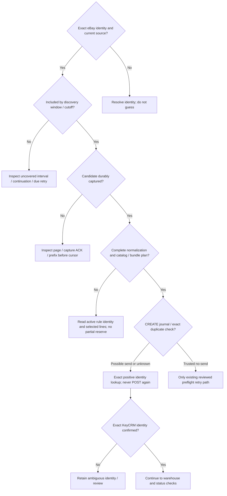
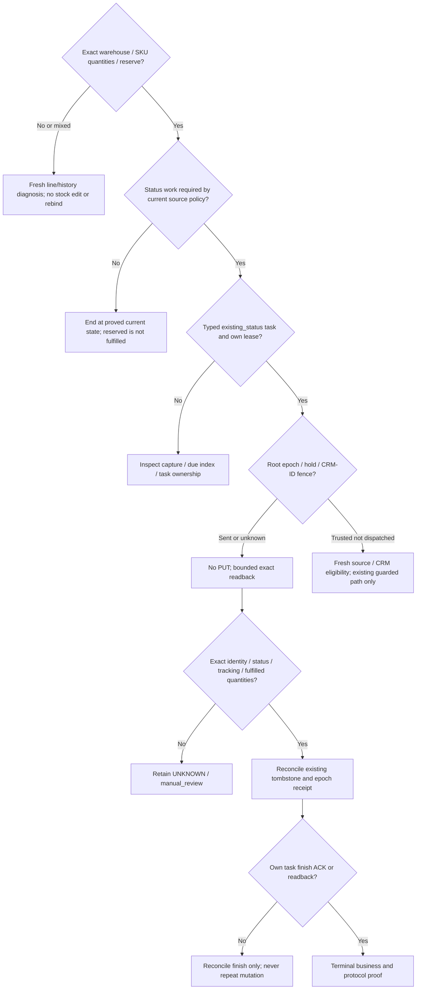

[← Case study](../README.md) · [Architecture index](full-system-map.md) · [Evidence labels](evidence.md)

# Order exists in eBay but is missing or incomplete downstream — where did it break?

Read-only forensic decision path, not permission to repair production. Establish exact source identity, observation time/revision and artifact context. Missing KV, a negative single GET, cursor advancement, task count zero or current DONE is never proof of no prior side effect.

## Source to CRM identity

## Warehouse to terminal proof

## Checkpoints: what absence means

| Checkpoint | Evidence expected | Absence does not prove | Next diagnostic / safe continuation |
| --- | --- | --- | --- |
| eBay identity / source | Exact order/selected variation/line and revision | CRM absence or safe fuzzy identity | Resolve exact source with approved reads |
| Discovery | Window/query/cutoff, page and continuation | Source missing | Identify uncovered interval, preserve cutoff |
| Candidate | Durable capture ACK and prefix | Cursor implies admitted work | Compare fetched IDs to stored coverage |
| Normalization | Full plan under one active rule version | Partial fallback is safe | Recompute only after authoritative mapping is valid |
| Catalog | Exact product/offer and component identity | Cache is live stock | Read designated authority; refresh derived cache separately |
| CREATE journal | preparing / pending / ambiguous / completed or trusted no-send | Missing KV means no POST | Inspect durable actor before caller report |
| CREATE effect | Exact positive CRM source correlation | Negative lookup means no historical order | Read-only identity reconciliation; retain uncertainty |
| Warehouse | Numeric warehouse and exact SKU quantities | Name/current total proves assignment/history | Fresh line and linked historical evidence; no guessed repair |
| Reserve | Reserved line state and quantity | CREATED means reserved; reserve means fulfilled | Revalidate independently before status eligibility |
| Status task | existing_status revision/due/own lease | No active task means no hold | Inspect delivery state separately from operation journal |
| Eligibility | Current money/refund/fulfillment/tracking policy | Printed label means shipment/stock effect | Read source and CRM under existing policy |
| Fence / epoch | mutation_pending, dispatch marker, hold/receipt, current epoch | Lease expiry authorizes send | Sent/unknown: no PUT; inspect original operation |
| Provider effect | Exact request/effect correlation if retained | Timeout/abort means cancellation | Bounded fresh GET; preserve possible-send evidence |
| Readback | Exact status/tracking/warehouse/fulfilled quantities | HTTP202 or current DONE proves historical finality | Match every required fact; otherwise review |
| Receipt | Completion tombstone and root epoch evidence | Business-looking GET means protocol settled | Reconcile existing receipt through owning protocol |
| Recovery / finish | Own finish token / last_finished_lease / retained review | Task complete means all other authorities settled | Reconcile metadata only; preserve separate holds |
| Terminal | Exact source + business/warehouse + operation/finish evidence | Any missing prerequisite is harmless | Retain review if proof is incomplete |

The diagnostic never sends a direct CREATE/PUT/APPLY, clears a fence, edits stock or invents a receipt. Source basis: the private ORDER_RECOVERY_DIAGNOSTIC_TREE (20-checkpoint forensic checklist), canonical state map and T01–T14. Public projection omits order identities and operational access details.
