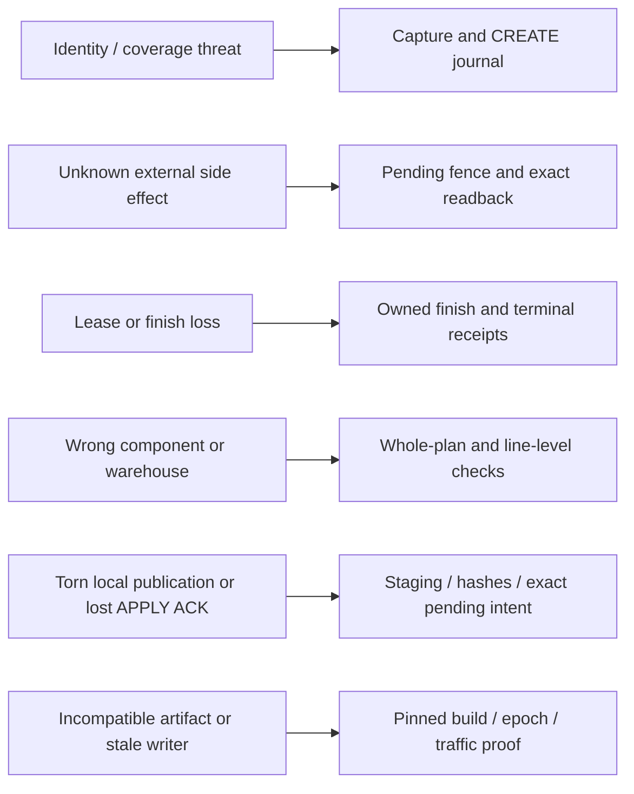

[← Case study](../README.md) · [Architecture index](full-system-map.md) · [Evidence labels](evidence.md)

# 28 implemented protection boundaries

**28 evidence-indexed safeguards**, not 28 proven live incident resolutions. IMPLEMENTED means a mechanism exists in the inspected source slice. Several have stronger local corrections, retained serving defects, or UNKNOWN installed-client identity. Canonical state ownership is in the [state map](state-authority-map.md); shorthand owner/SM aliases in the internal shortlist are not used as authority here.

## Identity / duplicate protection

### SG01 — Durable discovery capture before cursor advance

**IMPLEMENTED.** Candidate page lost while cursor moves → **Durable discovery capture before cursor advance** → **capture ACK / cursor** → Retain uncertainty; resume only the owning computation or reconciliation path, never infer permission to replay an effect.

Source basis: S2 runtime traces; SI01.

### SG02 — Bounded page continuation and fixed cutoff

**IMPLEMENTED + TESTED; local/retained variants.** Starvation from restarting pages; unbounded old-order recreation → **Bounded page continuation and fixed cutoff** → **frozen window and acknowledged prefix** → Retain uncertainty; resume only the owning computation or reconciliation path, never infer permission to replay an effect.

Source basis: BLOCK 01; B1-01/02/03 (retained defect/local correction boundary).

### SG03 — Exact source UUID plus serialized CREATE duplicate check

**IMPLEMENTED.** Concurrent/repeated source order CREATE → **Exact source UUID plus serialized CREATE duplicate check** → **source-identity actor result** → Retain uncertainty; resume only the owning computation or reconciliation path, never infer permission to replay an effect.

Source basis: S4 safety/recovery; T01/T03.

### SG04 — Possible-send journal persisted before CREATE dispatch

**IMPLEMENTED.** Duplicate POST after timeout/lost response → **Possible-send journal persisted before CREATE dispatch** → **create_state possible-send journal** → Retain uncertainty; resume only the owning computation or reconciliation path, never infer permission to replay an effect.

Source basis: T01/T03; B3-02.

## Readback / confirmation

### SG05 — Positive CREATE identity readback

**IMPLEMENTED + TESTED; local/retained variants.** Treating response or positive ID as exact CRM identity → **Positive CREATE identity readback** → **exact identity evidence** → Retain uncertainty; resume only the owning computation or reconciliation path, never infer permission to replay an effect.

Source basis: BLOCK 03; B3-01; T01.

### SG11 — Bounded fresh GET readback

**IMPLEMENTED.** Equating 200/202 with business and warehouse finality → **Bounded fresh GET readback** → **verified readback summary** → Retain uncertainty; resume only the owning computation or reconciliation path, never infer permission to replay an effect.

Source basis: BLOCK 03; T02/T04.

### SG26 — Fresh source, CRM and warehouse reads before transition

**IMPLEMENTED + TESTED; local/retained variants.** Acting on stale cached eligibility or stock projection → **Fresh source, CRM and warehouse reads before transition** → **fresh source and CRM summaries** → Retain uncertainty; resume only the owning computation or reconciliation path, never infer permission to replay an effect.

Source basis: T01/T02; S4.

## Warehouse / bundle correctness

### SG06 — Fresh warehouse-specific reserve proof

**IMPLEMENTED + TESTED; local/retained variants.** Treating binding/name/status as real reservation → **Fresh warehouse-specific reserve proof** → **fresh reserve/line evidence** → Retain uncertainty; resume only the owning computation or reconciliation path, never infer permission to replay an effect.

Source basis: BLOCK 04; T01/T07.

### SG12 — Exact fulfilled quantity and numeric warehouse validation

**IMPLEMENTED + TESTED; local/retained variants.** False DONE from status-only, alias or wrong warehouse → **Exact fulfilled quantity and numeric warehouse validation** → **exact fulfilled quantities/warehouse** → Retain uncertainty; resume only the owning computation or reconciliation path, never infer permission to replay an effect.

Source basis: BLOCK 04; T02; S4.

### SG18 — Bundle rule validation and fail-closed expansion

**IMPLEMENTED + TESTED; local/retained variants.** Partial, conflicting or overflowing bundle composition → **Bundle rule validation and fail-closed expansion** → **validated active rule version/whole plan** → Retain uncertainty; resume only the owning computation or reconciliation path, never infer permission to replay an effect.

Source basis: BLOCK 05; T07.

## Durable recovery

### SG07 — Typed `existing_status` task

**IMPLEMENTED.** Status work accidentally authorizes CREATE → **Typed `existing_status` task** → **typed task revision/lease** → Retain uncertainty; resume only the owning computation or reconciliation path, never infer permission to replay an effect.

Source basis: S4 safety/recovery; T02; SI03.

### SG13 — Completion tombstone and epoch receipt

**IMPLEMENTED.** Lost finish ACK redispatching completed mutation → **Completion tombstone and epoch receipt** → **tombstone / epoch / own-finish receipts** → Retain uncertainty; resume only the owning computation or reconciliation path, never infer permission to replay an effect.

Source basis: S4 safety/recovery; T02/T04.

### SG16 — Processing KV compatibility reader and merged safety flags

**IMPLEMENTED + TESTED; local/retained variants.** Legacy record shape or partial update erasing uncertainty/revision → **Processing KV compatibility reader and merged safety flags** → **merged processing safety/revision metadata** → Retain uncertainty; resume only the owning computation or reconciliation path, never infer permission to replay an effect.

Source basis: BLOCK 06; S4.

### SG17 — Capture handoff distinct from task completion

**IMPLEMENTED.** Cursor falsely representing terminal order work → **Capture handoff distinct from task completion** → **capture prefix + separate task** → Retain uncertainty; resume only the owning computation or reconciliation path, never infer permission to replay an effect.

Source basis: BLOCK 02; SI01-SI03.

### SG25 — Budget reservations, watchdog and Retry-After preservation

**IMPLEMENTED + TESTED; local/retained variants.** Admission after deadline, shortened backoff or delayed-phase drift → **Budget reservations, watchdog and Retry-After preservation** → **deadline/reserve/provider pause** → Retain uncertainty; resume only the owning computation or reconciliation path, never infer permission to replay an effect.

Source basis: BLOCK 08; T05.

## Release / cutover

### SG08 — Root STOP/DRAINED/RUN epoch and receipt

**IMPLEMENTED.** Mutation crossing an unproven cutover epoch → **Root STOP/DRAINED/RUN epoch and receipt** → **root epoch/control receipt** → Retain uncertainty; resume only the owning computation or reconciliation path, never infer permission to replay an effect.

Source basis: S4 safety/recovery; T02/T04.

### SG27 — Hash-pinned exact-version build and reverse-diff gate

**IMPLEMENTED.** Artifact drift or transform-scope mismatch → **Hash-pinned exact-version build and reverse-diff gate** → **artifact manifest / reverse diff** → Retain uncertainty; resume only the owning computation or reconciliation path, never infer permission to replay an effect.

Source basis: S1 operations/build/release; FINAL architecture map.

### SG28 — Upload, activation, traffic and RUN evidence separation

**IMPLEMENTED.** Upload/health mistaken for served compatible runtime → **Upload, activation, traffic and RUN evidence separation** → **exclusive upload / activation / traffic / RUN evidence** → Retain uncertainty; resume only the owning computation or reconciliation path, never infer permission to replay an effect.

Source basis: FINAL architecture map; S1; FINAL checklist.

## External mutation safety

### SG09 — Per-CRM mutation fence and invocation lock

**IMPLEMENTED.** Duplicate or concurrent PUT while result unknown → **Per-CRM mutation fence and invocation lock** → **CRM-ID mutation_pending** → Retain uncertainty; resume only the owning computation or reconciliation path, never infer permission to replay an effect.

Source basis: T02/T04; S4 safety/recovery.

### SG10 — Pending state and immediate dispatch marker

**IMPLEMENTED.** Dispatch without durable possible-send evidence → **Pending state and immediate dispatch marker** → **pending + epoch dispatch marker** → Retain uncertainty; resume only the owning computation or reconciliation path, never infer permission to replay an effect.

Source basis: T02/T04; S4 safety/recovery.

### SG14 — Unknown/sent/manual-review retention

**IMPLEMENTED.** Blind replay or clearing possible external effect → **Unknown/sent/manual-review retention** → **journal / root hold / manual_review** → Retain uncertainty; resume only the owning computation or reconciliation path, never infer permission to replay an effect.

Source basis: FINAL unknown register; T03/T04/T06.

### SG15 — Trusted-no-send retry boundary

**IMPLEMENTED.** Retrying after a request may have escaped → **Trusted-no-send retry boundary** → **trusted pre-dispatch phase** → Retain uncertainty; resume only the owning computation or reconciliation path, never infer permission to replay an effect.

Source basis: BLOCK 03; T03/T04.

## Catalog / Yellow

### SG19 — Live KV authority separated from snapshot/cache/reference

**IMPLEMENTED.** Derived catalog/client cache treated as rule or stock authority → **Live KV authority separated from snapshot/cache/reference** → **active authority versus derived snapshot** → Retain uncertainty; resume only the owning computation or reconciliation path, never infer permission to replay an effect.

Source basis: S3 pipelines/state; T07/T12.

### SG20 — Yellow staging and hash validation before publication

**IMPLEMENTED + TESTED; installed Yellow UNKNOWN.** Invalid workbook/package bytes advancing into run stages → **Yellow staging and hash validation before publication** → **staging / SUCCESS / hashes** → Retain uncertainty; resume only the owning computation or reconciliation path, never infer permission to replay an effect.

Source basis: S3 Yellow; T08.

### SG21 — Yellow `CURRENT_RUN` atomic presentation checkpoint

**IMPLEMENTED + TESTED; installed Yellow UNKNOWN.** Torn local run pointer/current state → **Yellow `CURRENT_RUN` atomic presentation checkpoint** → **CURRENT_RUN pointer** → Retain uncertainty; resume only the owning computation or reconciliation path, never infer permission to replay an effect.

Source basis: S3 Yellow; T08.

### SG22 — Exact APPLY command persistence and version/hash ACK

**IMPLEMENTED + TESTED; installed Yellow UNKNOWN.** Lost APPLY ACK treated as failure/no effect or replayed as new command → **Exact APPLY command persistence and version/hash ACK** → **pending exact command and positive ACK/cache receipt** → Retain uncertainty; resume only the owning computation or reconciliation path, never infer permission to replay an effect.

Source basis: BLOCK 07; T09/T10.

### SG23 — Complete outbox attention-set identity/reconciliation

**IMPLEMENTED + TESTED; local/retained variants.** Clipped rows or key collision hiding required attention → **Complete outbox attention-set identity/reconciliation** → **full attention-set / delivery identity** → Retain uncertainty; resume only the owning computation or reconciliation path, never infer permission to replay an effect.

Source basis: BLOCK 07; T11.

### SG24 — Independent snapshot publish-on-complete

**IMPLEMENTED.** Partial catalog pages replacing last valid snapshot → **Independent snapshot publish-on-complete** → **complete catalog envelope** → Retain uncertainty; resume only the owning computation or reconciliation path, never infer permission to replay an effect.

Source basis: S3/S4; T12; DG003.
