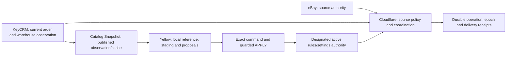

[← Case study](../README.md) · [Architecture index](full-system-map.md) · [Evidence labels](evidence.md)

# State ownership and authority boundaries

**40 modeled state entities = 30 named state families + 10 named Durable Object identity families.** These are not 40 SQL tables, literal enums, or a census of persisted rows. The 24 authority relationships below define what each observation can and cannot establish.

| Kind | Meaning | Cannot replace |
| --- | --- | --- |
| Authoritative state | Source facts, designated configuration, coordination ownership | Another service's independently owned fact |
| Observation | Fresh CRM order/warehouse readback | Historical linked request/movement proof |
| Cache / derived | Snapshot, projection, report | Active rules, reserve or mutation receipt |
| Proposal | Desired bundle/settings changes | Positive remote command ACK |
| Local client state | Staging, hashes, CURRENT_RUN, pending intent | Remote commit or installed-version proof |

## 30 state families

Literal names appear where supported; other phases are descriptive. Security lifecycle families are summarized without publishing predicates or token/key templates. R3/repair are staged, not live authority.

| ID | Family | Owner / classification | State meaning |
| --- | --- | --- | --- |
| SM01 | eBay source policy | eBay source authority | payment → refund → fulfillment → tracking (independent provider fields) |
| SM02 | KeyCRM business/stock | KeyCRM observed business / warehouse state | NEW1+reserved → DONE12+fulfilled → partial/null/mixed/unknown observations |
| SM03 | Processing KV | coordination / durable state | processed_legacy → reserved → completed → retryable_create → retryable_catalog_error → retryable_budget_deferred → confirmed_unknown_sku → catalog_fatal_error → created_pending_validation → completion_pending |
| SM04 | Discovery and scan checkpoints | coordination / durable state | uninitialized → frozen since/until+offset → acknowledged prefix/capture → finished overlap window |
| SM05 | CREATE identity journal | coordination / durable state | absent → preparing → pending+phase=in_flight → legacy in_flight → retryable_preflight → completed → ambiguous |
| SM06 | PUT mutation fence | coordination / durable state | plain lease → mutation_pending → confirmed completion tombstone → held/unknown/conflict |
| SM07 | Typed durable delivery and work kind | coordination / durable state | pending → leased → complete → manual_review → pending_revision → order_import/default missing kind → existing_status |
| SM08 | Cutover control | coordination / durable state | STOP → prepared STOP → DRAINED → RUN |
| SM09 | Epoch dispatch/settlement | coordination / durable state | unsent active → sent active → unknown active → confirmed/not_sent receipt → quarantined receipt+hold |
| SM10 | Holds/manual review/narrow release | coordination / durable state | legacy_unknown → sent/unknown hold → manual_review → reviewed released_at+audit → pending reviewed status task |
| SM11 | Provider cooldown | coordination / durable state | available → paused per origin → time-eligible |
| SM12 | Invocation budget/deadline | coordination / durable state | ordinary admission → critical tail reserved → exhausted/deferred → aborted/settling |
| SM13 | Yellow successful run publication | Yellow local / proposal; installed version UNKNOWN | staging/RUNNING → validated run → SUCCESS+hashes → CURRENT_RUN selected → PRODUCT_BLOCKED diagnostic → failed/orphan |
| SM14 | Product pending observation | Yellow local / proposal; installed version UNKNOWN | pending proposal → confirmation/conflict → reference committed → applied marker/report |
| SM15 | Bundle client command | Yellow local / proposal; installed version UNKNOWN | published input verified → previewed → pending exact command → acknowledged version/hash → unknown → retired result |
| SM16 | Bundle server APPLY | Active bundle authority + separate command receipt | CAS candidate → active KV written → post-write actor receipt → unknown boundary |
| SM17 | Settings client and cache continuation | Yellow local / proposal; installed version UNKNOWN | intent pending → unknown → remote committed receipt → cache repair pending → local synced/retired → proven stale rejected |
| SM18 | Legacy settings authority | Retained live KV settings authority | current versioned active settings → serialized command → updated active document → unknown command result |
| SM19 | R3 staged migration/authority | CANDIDATE / staged authority or derived state | absent → prepared → committed → aborted precommit → manual review/drift |
| SM20 | R3 immutable mirror | CANDIDATE / staged authority or derived state | mirror pending → identical version copy published → intent removed |
| SM21 | Snapshot and local catalog cache | Snapshot observation and local cache | building pages → complete cached snapshot → stale-valid → validated local cache → safe fallback/unsafe rejected |
| SM22 | Replenishment alert history | coordination / durable state | decision → attention report → queued/direct acknowledged → last_alert_at |
| SM23 | Notification outbox | coordination / durable state | pending → claimed lease → retry due → delivered finish/removal → age-pruned |
| SM24 | Notification/report dedupe | coordination / durable state | absent → owned pending → committed until expiry → released/expired |
| SM25 | Registered device authorization | coordination / durable state | Authorization / claim / consumed-result / retained uncertainty (protocol-specific) |
| SM26 | Device enrollment grant | coordination / durable state | Authorization / claim / consumed-result / retained uncertainty (protocol-specific) |
| SM27 | Generic one-time bundle capability | coordination / durable state | Authorization / claim / consumed-result / retained uncertainty (protocol-specific) |
| SM28 | Fixed confirmed-patch nonce/rollback | coordination / durable state | Authorization / claim / consumed-result / retained uncertainty (protocol-specific) |
| SM29 | Staged repair proposal/journal | CANDIDATE / staged authority or derived state | absent → dispatch_intent → applied_verified → reconciliation_required → receipt_persistence_uncertain |
| SM30 | Operational checkpoint/release journal | coordination / durable state | captured → verified/recovery-reviewed → built/sealed → upload intent/receipt → deployment intent/receipt → attested → RUN → unknown technical result |

## 10 named actor identity families

These are additional modeled entities, not extra deployed classes/namespaces. Identity templates and resource IDs are withheld.

| Family | Responsibility |
| --- | --- |
| DO01 | Source-identity CREATE journal |
| DO02 | Generic lock / per-CRM mutation specialization |
| DO03 | Root delivery/recovery/cutover coordination |
| DO04 | Bundle synchronization receipt |
| DO05 | Settings authority (staged R3 versus retained KV distinguished) |
| DO06 | Generic capability lifecycle |
| DO07 | Protocol-specific confirmed patch/rollback lifecycle |
| DO08 | Enrollment lifecycle |
| DO09 | Registered device lifecycle |
| DO10 | Notification delivery dedupe/outbox |

## 24 authority relationships

| ID / fact | Final authority | Cache / copy / observation limit |
| --- | --- | --- |
| AT01 — eBay order identity | eBay exact orderId + KeyCRM exact source_uuid/source_id/global identity correlation | No absence of old CREATE; title/amount not identity |
| AT02 — Selected SKU/variation and quantity | eBay selected order line/variation plus exact catalog identity and active rule expansion | No fabricated legacy SKU or parent listing inference |
| AT03 — Payment/refund | eBay current financial/refund source fields interpreted by existing policy | No shipping/physical stock effect implied by paid |
| AT04 — Fulfillment | eBay exact fulfillment/shipping events interpreted by policy | No proof of fulfilled CRM stock from label/source status alone |
| AT05 — Tracking | Exact eBay shipment tracking and verified CRM shipping readback | No delivered/shipped proof solely from label printing |
| AT06 — Current CRM order state | KeyCRM fresh exact order GET | No late historical request finality or stock proof solely from status |
| AT07 — Warehouse assignment | KeyCRM exact product-line numeric warehouse identity | No assignment inferred from warehouse name or catalog presence |
| AT08 — stock_status | KeyCRM product-line stock_status and exact expected quantity | No stock evidence from unrelated status alias |
| AT09 — Reserve | KeyCRM warehouse-specific reserve/line state and linked ledger | No ownership/history or no-double-deduction proof from aggregate balance |
| AT10 — Physical quantity/movement | KeyCRM warehouse ledger linked to exact order/operation | No historical causal chain from current balance alone |
| AT11 — Bundle meaning | Retained live KV designated active document effective version/hash,96 rules | No live authority override or safe deletion from absent fallback rule |
| AT12 — Catalog identity/current product | KeyCRM offers/products exact IDs | No current stock, remote product import or complete freshness proof |
| AT13 — Replenishment min/target | Retained live KV designated active document,278 settings; only approved future committed R3 could supersede | No physical quantity/reserve or command settlement; flag loss cannot undo future committed authority |
| AT14 — Successful Yellow preparation | CURRENT_RUN -> SUCCESS -> hashes -> validated selected run | No remote product/settings/bundle commit or single global transaction |
| AT15 — Remote bundle APPLY outcome | Positive exact command receipt/version/hash with protocol-specific reconciliation | No settlement of a lost legacy KV command from equality/time alone |
| AT16 — Remote settings APPLY outcome | Positive request/version/hash commit evidence; legacy unknown retained; genuine R3 receipt only after approved transition | No transactional legacy command receipt or permission to repeat unknown APPLY |
| AT17 — CREATE idempotency | Source-UUID durable create_state plus strict exact CRM duplicate evidence under actor | No new POST after possible send; completed identity not warehouse completion |
| AT18 — PUT idempotency | Per-CRM durable pending/completion fence plus exact fresh provider readback and cutover evidence | No second PUT after unknown or lost unlock/finish ACK |
| AT19 — Recovery task ownership | Transactional typed task lease/revision/due-index/last_finished_lease | No external mutation authority or tenant-global lock |
| AT20 — Manual review/hold | Each owning durable journal/root/task hold and evidence-specific reviewed release | No generic automatic release; task completion cannot erase separate unknown fence |
| AT21 — Release/deployment truth | Actual version-specific resources/code SHA + traffic attestation + applicable operation journals and reviewed safety proof | No serving identity/config/finality from same code hash or local PASS alone |
| AT22 — Notification delivery | Distinct outbox/dedupe/provider ACK/verification evidence | No human receipt or exactly-once notification proof under unknown remote response |
| AT23 — Catalog snapshot integrity | Complete service wire envelope hash/schema/time; client checks original wire bytes | No transformed-file checksum, stock authority or refresh from health |
| AT24 — Credential epoch/ownership | Approved consumer manifest + actual binding-version/auth evidence; current protected credential source | No equality/exclusivity or cancellation of preaccepted requests from name/old-key401 alone |
