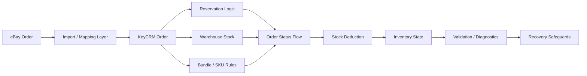

# eBay → KeyCRM: Order, Warehouse & Bundle Reliability

**Type:** Integration / CRM Automation / Debugging & Reliability  
**Environment:** Existing commercial integration

## Overview

I worked on an existing eBay → KeyCRM order-processing flow where order state, warehouse stock, reservations, bundles, and SKU-level inventory had to remain consistent across real operational scenarios.

This was not a greenfield build. My role was to trace the existing flow, diagnose failures, validate business logic, and harden the integration without replacing the surrounding system.

## Problem

The integration already imported eBay orders into KeyCRM, but reliability depended on several connected parts working correctly:

- warehouse-specific stock;
- reservation logic;
- bundle-to-SKU decomposition;
- order status transitions;
- stock deduction;
- recovery after partial or failed processing.

A failure in one stage could leave KeyCRM order state and actual inventory state out of sync.

## My Responsibility

- traced order flow from eBay into KeyCRM;
- analysed reservations and warehouse stock behaviour;
- investigated bundle/SKU edge cases;
- validated status transitions and stock deduction;
- reproduced problematic real-world order scenarios;
- diagnosed failure paths and recovery gaps;
- added and regression-tested reliability safeguards;
- kept production changes gated until the available evidence was sufficient.

## Technical Approach

The work was performed as a reliability investigation rather than a rewrite.

1. Map the existing order-processing flow.
2. Compare expected and actual behaviour on problematic orders.
3. Inspect reservation, warehouse, bundle, and status logic independently.
4. Reproduce failure scenarios and isolate the stage where state diverged.
5. Validate corrective/recovery behaviour with regression checks.
6. Avoid unsafe production changes when the source evidence was incomplete.

## Architecture

## Key Engineering Challenges

### Bundle and SKU consistency
One commercial item could map to multiple underlying SKUs. Partial processing could therefore produce an apparently valid order while leaving inventory incomplete.

### Warehouse-aware stock
Reservations and deductions had to reflect the correct warehouse state rather than a single abstract stock value.

### Failure recovery
The difficult cases were not normal successful orders, but partial and interrupted flows where the system had to avoid duplicate writes or inconsistent inventory.

### Safe production changes
Where the available evidence was insufficient to prove a production-safe fix, the release remained blocked rather than forcing a speculative change.

## Result

The integration was analysed at the order, warehouse, bundle, and stock-state levels. Problematic scenarios were reproduced, reliability safeguards were tested, and unsafe changes were kept out of production until the remaining evidence gaps could be resolved.

The value of the work was not a rewrite of the system, but a clearer and safer operational model for diagnosing and handling failure cases.

## Technology / Domain

- eBay order integration
- KeyCRM
- REST/API integration
- warehouse and reservation logic
- bundle / SKU processing
- order status workflows
- inventory consistency
- regression testing
- production diagnostics
- recovery design

## Privacy

This case is based on a live commercial integration. Client identity, credentials, customer/order data, API secrets, and confidential infrastructure details are intentionally omitted.
