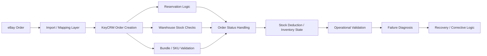

# eBay → KeyCRM Order, Warehouse and Bundle Integration

**Type:** Integration / CRM Automation / Debugging & Reliability

## Executive Summary

This work focused on the operational behaviour of an existing eBay → KeyCRM order-processing flow.

My responsibility was to analyse how real orders moved through the integration and verify the operational logic around warehouse stock, reservations, bundles, SKU handling, order statuses, and stock deduction.

The work was not a greenfield implementation. The integration already existed and required investigation, validation, correction, and reliability improvements for real operational scenarios.

## Problem

The integration had to correctly process eBay orders inside KeyCRM while keeping order state and inventory state consistent.

The main complexity was around:

- warehouse-specific stock;
- product reservations;
- bundle and SKU handling;
- order status transitions;
- stock deduction;
- failure scenarios and inconsistent order states.

Errors in any of these areas could create a mismatch between what KeyCRM showed and what was actually available or reserved in the warehouse.

## Existing System / Starting Point

The eBay → KeyCRM integration was already operational.

Orders were already entering KeyCRM, but the existing flow required deeper validation under real warehouse and bundle scenarios.

The task was to understand the existing behaviour, identify problematic paths, and improve the logic without treating the system as a new implementation from scratch.

## My Responsibility

My work included:

- tracing the order flow from eBay to KeyCRM;
- validating reservation logic;
- checking warehouse stock state;
- investigating bundle and SKU edge cases;
- analysing order status transitions;
- checking stock deduction behaviour;
- diagnosing failure scenarios;
- reviewing problematic real-world orders;
- identifying recovery gaps;
- improving validation and recovery logic.

## Technical Approach

I started by mapping the order-processing flow through the existing integration.

The main areas analysed were:

1. order import and mapping;
2. KeyCRM order creation;
3. reservation logic;
4. warehouse stock state;
5. bundle and SKU interpretation;
6. order status transitions;
7. final stock deduction;
8. failure and recovery behaviour.

Problematic scenarios were reproduced and compared against the expected operational flow.

The goal was not to replace the existing integration, but to make its behaviour more predictable and reliable under real-world conditions.

## Architecture

## Key Engineering Challenges

### Warehouse State

The integration had to operate correctly when stock was distributed across different warehouse states rather than treated as one abstract inventory value.

### Reservations

Reservation logic had to remain consistent with current stock availability and order processing.

### Bundles and SKUs

Bundle products introduced additional complexity because a single commercial item could depend on multiple underlying SKU positions.

### Order Statuses

Stock behaviour depended on the order lifecycle, so incorrect or inconsistent status transitions could affect reservations or deduction.

### Failure Recovery

Some scenarios required analysing what happened when an order path failed or stopped before reaching its expected final state.

The work therefore included not only normal-flow validation, but also investigation of abnormal and recovery scenarios.

## Result

The existing integration behaviour was analysed and improved around its most operationally sensitive areas.

The work provided:

- validated order-processing logic;
- improved understanding of warehouse and reservation behaviour;
- better handling of bundle/SKU scenarios;
- more consistent stock deduction logic;
- improved diagnosis of problematic orders;
- stronger failure and recovery handling.

No artificial performance metrics are included because the work was focused on correctness, operational reliability, and edge-case handling rather than synthetic benchmark improvements.

## Technology / Domain Stack

- eBay order integration
- KeyCRM
- CRM order processing
- API integration
- warehouse stock logic
- product reservations
- bundle / SKU processing
- order status workflows
- debugging and validation
- application and integration diagnostics

## Privacy / NDA

This case is based on a live commercial integration.

Client identity, credentials, private order/customer data, API secrets, and confidential infrastructure details are intentionally excluded.

The case describes only the engineering process, system behaviour, and my responsibility within the project.
