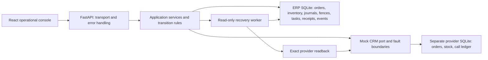
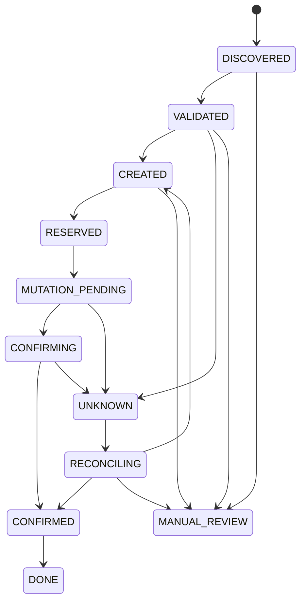

# Order Reliability Lab

[](https://github.com/Faleovad/portfolio/actions/workflows/order-reliability.yml)

[Actual console gallery](../../cases/ebay-keycrm-erp/architecture/demo-gallery.md) · [Commercial architecture → lab mapping](../../cases/ebay-keycrm-erp/README.md#executable-reliability-model)

An executable clean-room distributed-state simulation: a small ERP, an independent mock CRM, persistent reliability mechanisms, and an operational console.

**Technologies:** Python / FastAPI · SQLite · React / TypeScript · pytest · Playwright

This is public demonstration code inspired by the architectural principles discussed in the [commercial case study](../../cases/ebay-keycrm-erp/README.md). It contains no production implementation, credentials, customer data, or network adapter to a real marketplace/CRM. Demo behavior and measurements do not establish production behavior or performance.

## Run locally

Requires Python 3.12+ and Node.js 22+. Run one backend process and one frontend dev server. Commands below start from this directory.

```sh
python -m venv .venv
# Linux/macOS:
source .venv/bin/activate
# Windows PowerShell instead:
# .\.venv\Scripts\Activate.ps1
python -m pip install -r backend/requirements-dev.lock
python -m pip install --no-deps -e backend
cd backend
python -m uvicorn app.main:create_app --factory --host 127.0.0.1 --port 8000
```

In another terminal:

```sh
cd frontend
npm ci
npm run dev
```

Open [the local console](http://127.0.0.1:5173). API documentation is available at [the local OpenAPI UI](http://127.0.0.1:8000/docs).

Use **Reset / seed** to load the selected scenario, **Step** for one application stage, **Run** for bounded step playback, and **Recover** to reconcile an UNKNOWN order. Run renders committed backend responses; there are no independently animated business events. Injected interruptions intentionally pause execution: inspect state, then press Run again or restart the backend.

SQLite files live in `backend/.data` by default. Restarting the process preserves journals, inventory, tasks, receipts, events, and consumed faults. `LAB_DATA_DIR` may select a different local directory. Reset is intentionally destructive to this synthetic session only; there is no automatic reset on restart.

## Optional Docker Compose

The manual launch above is the established locally verified path. Docker is not installed in the visual-authoring environment, so no local Compose runtime result is claimed. The workflow validates Compose configuration, builds both containers, and tests persisted UNKNOWN across a backend restart; check its current result rather than inferring success from these files.

```sh
docker compose config
docker compose up --build --wait
# Open http://127.0.0.1:5173
docker compose down
```

The `lab-state` named volume stores both SQLite files. `down` retains it; explicit `down -v` destroys synthetic session state. Only frontend port 5173 is published, bound to loopback. Backend stays on the Compose network; nginx proxies the API. This remains a local unauthenticated lab, not a hosted production service.

## Architecture



`backend/app/api` only delegates commands and queries. Domain transitions, bundle policy, reservation settlement, and effect confirmation live outside routes. Provider reader/writer protocols make the read-only reconciliation boundary explicit.

| Component | Responsibility |
| --- | --- |
| `domain` | Typed enums, immutable inputs, structured errors, provider ports, permitted transitions. |
| `services` | Import, bundle expansion, local reserve, mutation dispatch, readback, recovery, settlement, and scenario orchestration. |
| `reliability` | Persistent CREATE identity, mutation ownership, immutable terminal proof, deterministic fault slots, bounded read policy, owned recovery leases. |
| `infrastructure` | Short SQLite transactions, event append, order persistence, independent mock CRM. |
| `scenarios` | Declarative input/fault plans; no scenario-name branching in reliability services. |
| `frontend/src/components` | Scenario controls, order/provider panels, stock/reservations, journals/fences/receipts, and event timeline. |

### Persistent state and authorities

Two physical SQLite files have no shared transaction. The ERP stores synthetic orders, warehouse inventory, reservations, CREATE journal, mutation fences, recovery tasks, immutable receipts, event history, and remaining fault plans. The provider independently stores CRM orders, warehouse inventory, and attempted/committed calls.

The console's **External CRM state** is an omniscient lab observer. It exposes actual provider state to the human, including commits the ERP cannot yet see. Application recovery never uses that observer as proof; it uses the fault-affected readback port.

The mock intentionally does **not** deduplicate CREATE by external identity. Duplicate protection must come from the ERP journal. The mock records a synthetic intent marker for exact effect correlation; this is a lab contract, not a claim that KeyCRM offers the same field or semantics.

### State machine



Every order transition is validated. DONE and MANUAL_REVIEW are terminal; UNKNOWN cannot jump to DONE or silently become a retryable failure. Journals and mutation fences have their own PREPARED / SENT / UNKNOWN / CONFIRMED lifecycle. An expired dispatch lease does not reopen SENT or UNKNOWN.

### Side effects and recovery

1. Validate the entire component plan. Persist the exact CREATE intent before dispatch.
2. Claim dispatch atomically; retain SENT before calling the independent provider.
3. Read exact identity after accepted CREATE. A lost response schedules observation, not another CREATE.
4. Reserve components locally in one transaction. Persist a separate fulfillment fence and recheck provider preconditions.
5. Send at most one fulfillment request per intent. Candidate acceptance is not confirmation.
6. Confirm exact identity, warehouse, component quantities, status, stock state, tracking, and intent correlation through bounded reads.
7. Store immutable terminal proof before local inventory settlement. Settle the local reservation once.
8. On uncertainty, claim a persisted recovery task, inspect its journal/fence, and perform bounded read-only reconciliation. Positive proof completes the owned task; insufficient evidence leads to manual review without releasing the fence.

Timeout-before-commit and commit-then-timeout look uncertain to the ERP but have different provider ledgers and stock. The latter is the key distributed-state scenario: the provider can be DONE while the ERP still has UNKNOWN and an outstanding local reserve.

### Bundles and inventory

`KIT-DESK` expands through nested `KIT-CORE` into two SENSORs and three CABLEs. Expansion sorts and aggregates components, rejects cycles/unknown SKUs/invalid quantities, and bounds recursion and quantity growth. Component reservation is all-or-nothing.

Inventory has `warehouse_id`, `on_hand`, `reserved`, `available = on_hand - reserved`, and cumulative `fulfilled`. Provider stock changes at provider commit. ERP stock changes only after confirmed effect proof. The two views may temporarily diverge; the console displays both.

## Executable scenarios

The catalog and expected outcomes are defined in `backend/app/scenarios/catalog.py`. Every catalog entry is executed by the parameterized integration suite.

| Scenario | Boundary demonstrated |
| --- | --- |
| Normal fulfillment / single SKU | Nested bundle or direct SKU through the same pipeline. |
| Insufficient components / cyclic rule | Reject a whole unsafe plan before CREATE. |
| CREATE response lost | Exact identity reconciliation without a second provider order. |
| Completion response lost | Confirm a committed stock effect without repeating it. |
| Timeout before commit / provider HTTP error | No proven effect; conservative manual review. |
| Delayed visibility / temporary read outage | Confirmation within the bounded read policy. |
| Stale response beyond confirmation budget | Persist a recovery task and continue observing. |
| Interrupt after CREATE / after prepared fence | Resume from durable state at different side-effect boundaries. |
| Lose final acknowledgement | Terminal receipt and settlement survive the missing reply. |
| Committed but not provable | Human observer sees the effect; ERP correctly refuses to claim proof. |

Fault modes are persisted and consumed deterministically: before commit, commit then timeout, HTTP error, delayed visibility, readback failures, interruption, acknowledgement loss, and stale response. Delay is modeled in read attempts rather than wall-clock sleeps. Fault selection lives in one module and the provider/checkpoint boundaries.

## Tests and metrics

From the demo directory with the virtual environment active:

```sh
cd backend
python -m pytest -q --junitxml=test-results/backend.xml
python -m ruff check .
cd ../frontend
npm run build
npx playwright install chromium
npm test
cd ..
python tools/metrics.py
```

The suite covers duplicate CREATE admission, terminal replay protection, uncertain mutation expiry, exact tracking/warehouse proof, all-or-nothing reserves, provider transaction rollback, delayed/stale reads, task ownership, immutable proof, and a real subprocess recovering persisted UNKNOWN state. Browser tests drive the real React UI and FastAPI backend, including interruption, page reload, terminal replay, mobile layout, and API error states.

`tools/metrics.py` counts authored source lines, meaningful modules, registered API methods, actual SQLite tables, fault enums, executable scenarios, collected pytest cases, and executed browser results. It excludes dependencies, generated builds, locks, virtual environments, and local state. Physical LOC includes comments and blank lines. Metrics are demo measurements only.

The checked-in [local verification receipt](docs/VERIFICATION.json) records measured counts, executed test results, and source SHA-256 identities. Regenerate it with `python tools/metrics.py --write-report` after running both test suites. The command refuses to record a passing snapshot without complete successful backend and browser results. The validated dependency set emits an upstream Starlette HTTPX TestClient deprecation warning; it did not fail the tests.

## Deliberate limits

- A single-process local laboratory with one active scenario/order per session; no claim of multi-process command orchestration or tenant-global coordination. Database-backed dispatch and recovery ownership are still tested under competing claimants.
- No real eBay/KeyCRM HTTP traffic. Mock operations model commit/response/read-visibility boundaries in process over an independent database; injected HTTP errors simulate an upstream response rather than run a third server.
- Read/lease policy is bounded and deterministic. Manual review is terminal in the lab; there is no force-release or stock-edit endpoint.
- Local loopback use only: reset and observer endpoints have no authentication. This is not a hosted multi-user service or a production release candidate.
- No automatic unknown replay, globally guaranteed exactly-once delivery, provider cancellation, linked historical ledger reconstruction, or catastrophic recovery claim.
- Interruption checkpoints throw after committed stages; the subprocess test checks disk persistence. This is not a power-loss/filesystem-corruption test or an exhaustive scheduler proof.

## Reading order

Start with `domain/transitions.py`, `services/engine.py`, `reliability/journals.py`, `services/mutations.py`, `services/recovery.py`, then `infrastructure/mock_crm.py` and the failure/restart tests. The UI presents the same persisted facts; it is not the source of business state.
